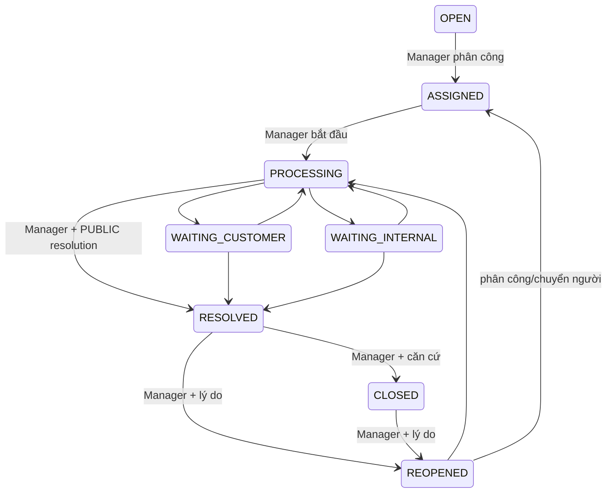

# Commit 17 — Customer Support Portal

> Commit 18: [Admin Reports & Audit](admin-reports-audit.md) đọc ticket cohorts và action/time/actor metadata cho Admin. REOPEN_REQUESTED vẫn tách khỏi REOPENED; PUBLIC/INTERNAL message body không vào báo cáo hoặc audit viewer. Không đổi customer ownership, routing, idempotency hoặc notification target.

Phụ trách: Tân. Nhánh: `feature/tan-customer-support`.

Đầu phiên, working tree sạch trên main `3881d16`, đã merge Commit 16 (`0306610`) và có đầy đủ lịch sử Commit 01–15, gồm bản bổ sung source Commit 11. Tạo nhánh yêu cầu từ main này. Baseline thực tế: **922 tests, 921 passed, 0 failures, 0 errors, 1 skipped**. Không stage/commit/push/merge/stash/PR. Không kết nối, chỉnh dữ liệu hoặc chạy migration trên SQL Server thật; không đổi cấu hình DB/SMTP, dependency hay Flyway V1–V11.

## 1. Phạm vi và kiến trúc

Mở customer portal trên ticket root của Commit 16. `TicketService` tiếp tục là write service duy nhất, bổ sung ba thao tác có method security ROLE_USER: `createCustomer`, `customerMessage`, `requestCustomerReopen`. Các thao tác Manager giữ nguyên route và state machine. Mở rộng `TicketCustomerReadService`, không dùng Manager Detail DTO cho khách.

Tái sử dụng SupportTicket, SupportTicketMessage, SupportTicketEvent, SupportTicketAssignment, TicketStatus/Category/Source/MessageKind, Shipment/User, repositories hiện có và notification/WebSocket Commit 15–16. Không thay ShipmentStatus, giá snapshot, lifecycle logistics hoặc code quote/pricing. Không có Guest support, upload, rich text, chatbot, email/SMS/Zalo hay WebSocket server thứ hai.

## 2. Route và giao diện

| Method | Route | Chức năng |
|---|---|---|
| GET | `/account/support` | List, filter, page 0..100000, size 1..50 (mặc định 20) |
| GET | `/account/support/new` | Form; shipmentId chọn trước phải được xác minh lại; shipmentPage phân trang 20 |
| POST | `/account/support` | Tạo ticket với DTO allowlist và token |
| GET | `/account/support/{ticketId}` | Chi tiết customer, page trao đổi 20 |
| POST | `/account/support/{ticketId}/messages` | Gửi PUBLIC message, version + token |
| POST | `/account/support/{ticketId}/reopen` | Gửi yêu cầu xem xét mở lại, version + token; không tự reopen |

MVC server-rendered Thymeleaf và Bootstrap local, tiếng Việt; không tạo JSON ticket API song song. `/api/account/support` vẫn bị deny theo cấu hình mặc định. API thông báo hiện hữu tiếp tục được dùng bởi chuông/trung tâm thông báo.

Templates `support/list`, `new`, `detail`, `error`, `fragments`; reuse head/nav và CSS của shipments. Bootstrap grid xuống một cột trên điện thoại. List có empty state, filter, pagination; detail có vấn đề ban đầu, kết quả giải quyết công khai, trao đổi, thông báo CLOSED, form bổ sung/yêu cầu mở lại theo quyền. Toàn bộ thời gian hiển thị UTC. Có link từ account, navigation USER, chi tiết vận đơn và notification center. Không viết lại layout/Manager UI.

List sort createdAt DESC, id DESC. Bộ lọc ALL; WORKING gồm OPEN/ASSIGNED/PROCESSING/WAITING_INTERNAL/REOPENED; WAITING_CUSTOMER; RESOLVED; CLOSED. WAITING_INTERNAL hiển thị cho khách là “Đang xử lý”, không mô tả điều tra nội bộ. Trao đổi sort createdAt ASC, id ASC, phân trang 20; có link tới trang mới nhất. Kết quả giải quyết gần nhất vẫn hiện ở đầu detail dù message nằm ở trang khác.

## 3. Ownership và quyền thực tế

`Shipment.sender` là chủ vận đơn. Customer identity lấy từ Principal email qua NotificationIdentity và CustomerSupportAccess; cần User ACTIVE, ROLE_USER trong session và database. ADMIN/MANAGER/SHIPPER không mặc nhiên kế thừa ROLE_USER. Khách đã mất role hoặc LOCKED/UNVERIFIED bị chặn dù giữ session cũ.

Mỗi ticket được xem/ghi phải đồng thời có `ticket.user.id = currentUser.id`, `ticket.shipment.sender.id = currentUser.id` và handlingBranch đã xác định. Repository customer còn kiểm tra User ACTIVE và DB ROLE_USER. User không phải chủ/ID không tồn tại trả cùng 404, không dùng code/tracking/phone để cấp quyền. Các service mới có method security, không chỉ bảo vệ controller/template.

Manager intake từ Commit 16 lấy requester từ sender thật; nguồn MANAGER_PHONE/EMAIL/COUNTER, createdBy là Manager thật. Khách đúng ownership kép có thể thấy chủ đề/trạng thái và PUBLIC messages của ticket đó, nhưng **không thấy content intake nội bộ**, assignment/audit hay resolution_notes trực tiếp. Ticket legacy chưa có branch/requester xác thực không tự được backfill hoặc mở quyền. Source CUSTOMER chỉ được tạo qua method customer; Manager create hiện hữu vẫn từ chối giả source CUSTOMER.

Customer DTO có allowlist rõ ràng: code, subject, category, status label, tracking, timestamps, message body/time và nhãn “Bạn/Chi nhánh hỗ trợ”. Không trả tên/ID/email nhân viên, user IDs, assignee, priority nội bộ, branch routing, AuditLog, nội dung INTERNAL, contacts hoặc giá. Ticket ID/version là reference cho thao tác đã được kiểm tra ownership, không phải bằng chứng cấp quyền. Không serialize entity ra HTTP.

## 4. Định tuyến chi nhánh và tạo ticket

Chính sách đã được người dùng xác nhận trong phiên: **cấu hình định tuyến trong database**, không tự lấy origin/destination làm mặc định.

V12 thêm `support_ticket_routes`: một cấu hình duy nhất cho mỗi origin_branch_id, có handling_branch_id và is_active. Không seed, không tự tạo branch/manager. Khi tạo, service:

1. Khóa User hiện tại, refresh trạng thái và đọc lại role.
2. Kiểm tra replay token của chính người tạo bằng fingerprint gốc.
3. Tìm shipment bằng ID + sender ID thật.
4. Đọc cấu hình ACTIVE cho origin branch thật của shipment bằng khóa đọc.
5. Xác minh origin và handling branch ACTIVE, handling branch có quan hệ origin/destination/currentBranch với shipment như điều kiện tiếp nhận Commit 16.
6. Không có cấu hình hoặc cấu hình không hợp lệ: trả lỗi rõ ràng, không tạo một phần ticket/event.
7. Ghi requester/createdBy từ User thật, source CUSTOMER, status OPEN, priority MEDIUM theo default hiện hữu, chưa assignee. Snapshot warningDueAt nếu OperationsSettings đã bật, không tự dựng SLA.
8. Root + CREATED event + actor/branch snapshot cùng transaction. Shipment và phí không thay đổi.

Sau khi deploy và review V12, người vận hành cần cấu hình các tuyến thật qua quy trình quản trị DB được ủy quyền. Ví dụ về **chính sách**, không phải seed: origin A → support A hoặc origin A → destination B khi đó là quan hệ hợp lệ. Nếu cấu hình trỏ đến branch không còn liên quan, việc tạo bị từ chối. Cấu hình không tự chuyển branch của ticket đã tồn tại. Commit này không có UI sửa routing, không thao tác DB thật và không yêu cầu credentials.

## 5. Customer conversation và INTERNAL/PUBLIC

Create DTO chỉ nhận shipmentId/category/subject/content/token. Message/reopen DTO chỉ nhận version/body/token. Các field giả requesterUserId, userId, senderId, actor, createdBy, source, kind, status, priority, assignee, branch, timestamps không có chỗ để bind vào entity.

Subject tối đa 200 ký tự; mô tả/message/lý do mở lại tối đa 2000, bắt buộc không blank. Validation ở service qua @Validated/@Valid và tại MVC. Timestamp server UTC cắt 100ns. Body plain text, template dùng th:text/th:field/th:errors; không th:utext, raw HTML, hidden internal notes hoặc nội dung entity trong data attributes.

Customer message luôn PUBLIC, author từ Principal, action CUSTOMER_MESSAGE với message FK. Manager đọc được qua message/timeline cũ. INTERNAL note do Manager ghi không vào customer query, DTO, HTML hay notification. Original content chỉ hiển thị nếu source CUSTOMER và createdBy trùng chủ tài khoản. Resolution chỉ lấy từ **message PUBLIC gắn event RESOLVED**, không tự công khai trường resolution_notes hoặc legacy resolution chưa có bằng chứng PUBLIC.

Messages/events append-only trong service, business fields updatable=false. Không thêm endpoint edit/delete. Một lỗi ghi event phải rollback message/root/version. Reply không tự đổi TicketStatus, kể cả WAITING_CUSTOMER: Manager tiếp tục transition theo policy Commit 16. Đây là lựa chọn có chủ đích để tránh khách làm đổi luồng xử lý nội bộ.

## 6. State machine và yêu cầu mở lại

Giữ nguyên lifecycle:



Khách được gửi bổ sung ở OPEN/ASSIGNED/PROCESSING/WAITING_CUSTOMER/WAITING_INTERNAL/REOPENED. RESOLVED/CLOSED chỉ đọc và yêu cầu xem xét mở lại. Customer không tự resolve/close/assign/classify/transfer branch hoặc thay ShipmentStatus.

Yêu cầu mở lại chỉ từ RESOLVED/CLOSED, bắt buộc lý do, lưu PUBLIC message + REOPEN_REQUESTED event nhưng **giữ nguyên status/resolvedAt/closedAt**. Một yêu cầu đang chờ trong mỗi chu kỳ giải quyết; retry cùng token trả thành công, token mới không tạo thêm yêu cầu pending. Pending được xác định bằng lịch sử: REOPEN_REQUESTED chưa có REOPENED hoặc RESOLVED sau đó. Manager xem lý do ở message/timeline hiện hữu và dùng thao tác reopen có sẵn; actual reopen xóa pending theo lịch sử, không xóa message/event cũ.

Không hardcode số ngày được reopen hay tổng số chu kỳ. Không có workflow riêng để Manager từ chối/đóng một reopen request; có thể trả lời PUBLIC, nhưng cờ pending chỉ được kết thúc bằng actual REOPENED hoặc lần RESOLVED tiếp theo. Nếu cần quy trình chấp thuận/từ chối riêng, bổ sung action/model có audit ở commit sau, không giả rằng đã xử lý yêu cầu khi chỉ có reply.

## 7. Transaction, version và idempotency

Write customer có transaction timeout 15 giây. Create khóa account để serialize concurrent create/replay. Message/reopen khóa ticket root cùng policy PESSIMISTIC_WRITE của Commit 16, rồi khóa/refresh User, kiểm tra lại quyền và ownership, so expected @Version. Root được touch kể cả khi chỉ thêm message, nên customer và Manager dùng chung version, không last-write-wins.

DB quyền/scope bị thu hồi trong lúc chờ root lock có thể trả 403 hoặc 404 theo thời điểm predicate được đánh giá; đều không ghi dữ liệu. Chuyển branch làm tăng version, form cũ conflict 409. Commit này không mở API chuyển branch; test mô phỏng thay đổi này trên H2 để bảo vệ các extension tương lai.

Create dùng request_token/fingerprint root đã có từ V11. Hash SHA-256 length-delimited của operation CUSTOMER, shipmentId, category, subject/content canonical; immutable, không lấy từ client và không phụ thuộc classification/routing có thể đổi về sau. Replay chỉ của actor thật và còn ownership, cùng payload trả cùng ID; payload khác từ chối.

Message/reopen có request_token và request_fingerprint nullable mới ở V12. Fingerprint bao gồm loại thao tác, ticket ID, body canonical; không gồm version để retry có thể thành công sau khi root đã đổi version/status. Replay được kiểm tra **sau ownership/active checks nhưng trước version/state/throttle**. Không được dùng token của ticket/thao tác khác. Filtered UNIQUE token là lớp bảo vệ DB cuối, tương tự root. Message/event/root cùng commit; rollback không tiêu thụ token DB.

Hai yêu cầu khác token là hai ý định khác; không chặn mọi ticket cùng shipment/category, và có thể tạo yêu cầu mới sau ticket CLOSED. Không deduplicate bằng nội dung giống nhau một cách âm thầm. UI form server cấp token UUID32; không dựa vào disable button frontend để chống lặp.

Khóa/thứ tự truy vấn có thể dẫn tới timeout/deadlock trong SQL Server khi chạy cùng các transaction ngoài module; lỗi DB/lock được trả 409/503 chung, client tải lại/retry với token cũ. Chưa kiểm chứng isolation/execution plan SQL Server, không khẳng định H2 chứng minh mọi race của SQL Server.

## 8. Chống spam

Tái sử dụng implementation fixed-window bounded của TrackingRateLimiter, nhưng quota độc lập theo authenticated DB User ID trong CustomerSupportThrottle. Áp dụng service-side cho create/message/reopen mới, sau replay. Default kỹ thuật 20 write attempts/phút/User/node, tối đa 10000 User windows; cấu hình `uteexpress.support.rate-limit.writes-per-minute`, `uteexpress.support.rate-limit.max-users`. Không sửa application.properties. Đây là guard chống quá tải có thể chỉnh, không phải giới hạn nghiệp vụ số ticket.

Vượt quota/full registry trả 429 + Retry-After giây; không evict quota còn sống để tránh reset. Validation/ownership fail trước bước throttle; write rollback có thể vẫn tiêu thụ quota RAM. Giới hạn mất khi restart và không chia sẻ giữa node; cần proxy/distributed throttling và giám sát nếu triển khai nhiều instance hoặc chống abuse quy mô lớn. Không tuyên bố đã chống spam đầy đủ.

## 9. Manager Ticket và Dashboard

Root CUSTOMER có handlingBranch rõ ràng nên tự xuất hiện trong `/manager/tickets`, OPEN/unassigned queue và ticket aggregates `/manager/operations` cùng queries Commit 16. Không có danh sách thứ hai hoặc thuật toán KPI mới. ManagerBranch/Employee ACTIVE + role/scope hiện hữu vẫn áp dụng; branch khác không đọc ticket này.

Source CUSTOMER hiển thị tiếng Việt; CUSTOMER_MESSAGE/REOPEN_REQUESTED được bổ sung vào labels và audit allowlist. Manager đọc text ở PUBLIC message, ghi INTERNAL riêng, trả lời/assign/status/resolve/close/reopen qua service cũ. Không copy state machine vào controller customer và không đổi URL Manager.

## 10. Notification và WebSocket

Luồng duy nhất: **ticket transaction commit → SupportTicketEvent pending → TicketNotificationWorker/Processor → Notification DB + ack event cùng transaction riêng → NotificationWorker/Delivery → private REFRESH → API reconciliation**.

| Event | Recipient theo DB hiện tại |
|---|---|
| CREATED source CUSTOMER, actor/requester hợp lệ | Manager hợp lệ của handling branch; không mọi ROLE_MANAGER |
| CUSTOMER_MESSAGE / REOPEN_REQUESTED | Assignee còn hợp lệ; nếu không có/không còn hợp lệ, Manager hợp lệ tại handling branch |
| ASSIGNED / REASSIGNED | Giữ snapshot Manager mới/cũ Commit 16 |
| PUBLIC_REPLY / RESOLVED | Chủ ticket ACTIVE/ROLE_USER, khớp requester và sender |
| WAITING_CUSTOMER, hoặc PROCESSING từ WAITING_CUSTOMER | Chủ ticket, thông báo tiến độ có ý nghĩa |
| CLOSED | Chủ ticket, không đưa căn cứ nội bộ vào notice |
| REOPENED thực tế | Giữ notice assignee và thêm notice chủ ticket |
| INTERNAL_NOTE / phân loại/priority / WAITING_INTERNAL | Không phát cho khách |

Manager recipient cần User ACTIVE, DB ROLE_MANAGER, Employee ACTIVE, employee home branch đúng branch và ManagerBranch thật, branch ACTIVE. Fan-out theo page100, tối đa1000 như quy ước notification Commit15; vượt giới hạn fail toàn transaction và retry, không bỏ im lặng recipient. Các event branch không còn khớp ticket không được gửi sai scope. Notification customer vẫn kiểm tra ownership kép + handlingBranch, ACTIVE/role tại list/count/read/open/delivery.

Unique sourceTicketEvent/User/audience của V11 và lock event giữ retry không trùng DB. Không gọi broker từ TicketService hoặc HTTP request. Notice không chứa original description/message, internal notes, audit/PII hoặc URL người dùng nhập; chỉ tiêu đề được allowlist + ticket code và text chung. WebSocket vẫn `/ws/notifications` và `/user/queue/notifications`, payload duy nhất `{type:"REFRESH"}`, CONNECT CSRF/same-origin/private subscribe/deny client SEND/session revocation giữ nguyên.

Notification target USER nay là `/account/support/{ticketId}`; Manager vẫn `/manager/tickets/{ticketId}`. Target được dựng từ reference DB sau visibility check, không nhận returnUrl. User offline/reconnect đọc lại API/badge/trung tâm notification; không cần WebSocket để gửi ticket/message. deliveredAt chỉ local channel acceptance, không phải browser ACK/exactly-once. Simple broker, multi-node và monitoring còn cùng giới hạn Commit15.

## 11. V12 và tính tương thích

V12 cần thiết, không phải migration rỗng:

- Cấu hình routing thật cho customer intake chưa tồn tại ở V11: support_ticket_routes, FK branches NO ACTION, unique origin, BIT default1. Entity/Repository mới duy nhất phục vụ cấu hình này, không tạo ticket root/message table trùng.
- request_token VARCHAR32 và request_fingerprint VARCHAR64 nullable trên support_ticket_messages, CHECK phải cùng NULL hoặc cùng đủ độ dài và PUBLIC; UNIQUE filtered non-null. Không chuyển INTERNAL thành PUBLIC hoặc backfill token.
- TicketAction CHECK thêm CUSTOMER_MESSAGE và REOPEN_REQUESTED; TicketStatus/ShipmentStatus giữ nguyên.
- Index customer `(user_id,created_at DESC,id DESC)` và event lookup `(ticket_id,action,id)`.

JPA giữ LAZY/no cascades remove/all/orphan; token/fingerprint business fields updatable=false. Không sửa V1–V11 hoặc DML seed/backfill ticket/routing. Nullable columns giữ messages cũ, manual Manager methods không cần token mới. Không thay fee snapshot hoặc vận đơn legacy.

Offline mapping tests đối chiếu cumulative V1/V3–V12 với SQLServerDialect: **41 entities, 153 FK, 40 identity, 53 enum VARCHAR, 28 portable unique constraints**, checks/index/types/defaults/nullable và repository query initialization. Filtered unique index được assert SQL vì JPA portable @Index không mô tả được filter. Các H2 integration tests dùng schema Hibernate create-drop, **không chạy migration T-SQL V12**.

Cutover: review/chạy migration có chủ đích trên môi trường được ủy quyền, dừng writer/worker cũ rồi triển khai code hỗ trợ action mới trên mọi node; binary cũ không hiểu enum mới và worker cũ có thể xử lý CREATED không đúng policy customer. Không cam kết rolling deployment trộn Commit16/17. Chưa chạy SQL Server migration/Hibernate validate trong phiên này.

## 12. Kiểm thử

Các nhóm mới:

- CustomerSupportJdbcTests: actual JPA/validation/authorization/owned query/routing/filtered list/public conversation/pagination/replay/fresh roles/state policy/public resolution/notification recipients/targets, không Shipment mutation.
- CustomerSupportConcurrencyTests: actual H2 row locks và transactions; cùng token create/message/reopen; khác message cùng version; Manager reply/resolve/close/reopen races; lock wait + account/role revocation hoặc branch change; outer rollback; H2 audit/notification constraint failure; atomic worker retries và private delivery signal.
- CustomerSupportMvcTests: actual MVC/security/Thymeleaf + H2 services; CSRF/mass assignment/404 enumeration/XSS/empty/filter/pagination/manual intake privacy/Manager compatibility/customer links. Chỉ QuoteService không nằm trong flow được mock ở context này; regression pricing đầy đủ chạy riêng trong suite cũ.
- CustomerSupportThrottleTests: per-user quota, Retry-After, expiry, bounded registry, invalid settings.
- Thêm test NotificationWebSocketTests: actual embedded Tomcat, HTTP login/session, Java HttpClient WebSocket/STOMP private delivery, reconnect API và ticket redirect; persistence trong nhóm socket là Mockito, không phải JDBC. H2 transaction tests độc lập kiểm chứng ghi notice/outbox/rollback; không trộn hai mức thành tuyên bố SQL Server end-to-end.

Kết quả xác nhận cuối ngày 25/10/2026:

| Kiểm tra | Kết quả |
|---|---|
| `.\mvnw.cmd clean test` | BUILD SUCCESS: **1031 tests, 1030 passed, 0 failures, 0 errors, 1 skipped**; đối chiếu lại tất cả Surefire XML |
| CustomerSupportJdbcTests | 56 passed |
| CustomerSupportConcurrencyTests | 18 passed |
| CustomerSupportMvcTests | 30 passed |
| CustomerSupportThrottleTests | 4 passed |
| NotificationWebSocketTests | 17 passed (16 regression + 1 ticket integration mới), embedded Tomcat thật, mock persistence |
| Regression baseline | 922 tests ban đầu được giữ; tăng 109 test (108 Customer Support + 1 WebSocket) |
| JS notifications / operations | 6 + 3 checks passed, Node runtime qua node_repl; Node CLI chưa có trong PATH; không thay/thêm JS |
| HTML support templates | Cả 5 file có thẻ đóng/mở cân bằng qua Python HTMLParser; actual Thymeleaf render trong MockMvc |
| Compile riêng | BUILD SUCCESS với `.\mvnw.cmd -DskipTests compile` |
| `git diff --check` | Sạch, xác nhận lại cuối phiên |

Warnings còn tồn tại: Maven metadata Flyway Community repository HTTP401 (build vẫn thành công); Mockito/ByteBuddy dynamic agent trên Java21; Hibernate SQLServerDialect explicit warning trong offline mapping test có chủ đích. Các warning CHECK violation là fault injection H2 để kiểm tra rollback; unsupported method/invalid enum và STOMP denial là các ca kiểm thử từ chối mong đợi, không phải lỗi suite. Không sửa cấu hình dependency chỉ để che cảnh báo.

Không chạy trình duyệt đồ họa/visual QA, benchmark dữ liệu lớn, SQL Server JDBC migration/ddl-auto=validate. Test SQL Server opt-in hiện hữu được skip có chủ đích; nó đang dùng Windows integrated authentication trong khi database thực tế của người dùng dùng SQL Server Authentication. Không bật test này, không sửa connection configuration hoặc yêu cầu mật khẩu.

## 13. Kiểm tra thủ công với hai USER và một MANAGER

1. Trên môi trường được ủy quyền, review V12, chủ động migration và Hibernate validate; cấu hình route ACTIVE cho origin thực và handling branch liên quan. Chuẩn bị USER A/B và Manager có Employee/ManagerBranch thật; không tạo tài khoản mẫu từ commit này.
2. A mở account → Hỗ trợ; từ vận đơn A chọn “Yêu cầu hỗ trợ vận đơn này”. Form chọn đúng shipment; gửi valid text, xem ticket OPEN/chờ xử lý. Kiểm tra tổng phí/status shipment không đổi.
3. Tải lại POST hoặc hai tab cùng token: chỉ một ticket. Payload khác cùng token phải lỗi. B dùng ticketId/shipmentId của A ở URL/POST: 404, không có dữ liệu A.
4. Manager vào list/dashboard đúng branch thấy CUSTOMER ticket, assign nhân sự hợp lệ, bắt đầu PROCESSING, thêm INTERNAL marker và PUBLIC reply. A chỉ thấy PUBLIC, không thấy marker dù View Source. Manager branch khác bị chặn.
5. A gửi bổ sung khi đang mở/WAITING_CUSTOMER; Manager đọc được tác giả/nội dung qua trang hiện hữu. Thử hai tab cùng version, reply đồng thời với Manager resolve: conflict có yêu cầu reload, không mất history.
6. Manager resolve với PUBLIC resolution rồi close. A vẫn đọc timeline/kết quả; không còn form message. A yêu cầu xem xét mở lại có lý do: status vẫn RESOLVED/CLOSED, một pending request. Manager thấy yêu cầu, actual reopen theo route cũ; A nhận thông báo và được gửi message lại.
7. Mở hai browser profile A/B; Manager reply: chỉ A có badge/notice, target `/account/support/{id}`, không nội dung/PII trong frame WebSocket. Ngắt mạng, gửi/nhận thông báo khi offline, reconnect và kiểm tra API đồng bộ. B không mở notice của A.
8. Thiếu CSRF phải 403. Khóa A hoặc thu hồi ROLE_USER trong DB theo quy trình quản trị được ủy quyền: session cũ không đọc/ghi support/notice. Không đổi origin policy hay mở public topics để test.
9. Thử `<script>`/HTML trong subject/body: hiển thị text. Thử thiếu route, branch INACTIVE, route không liên quan: lỗi rõ ràng, không có root/event giả. Kiểm tra mobile viewport, focus/labels, pagers và trạng thái lỗi/empty bằng trình duyệt thật.

## 14. Giới hạn và nối Commit 18 — Reports & Audit

Commit18 nên đọc history actor/action/time/branch/message reference sẵn có, kiểm tra scope theo DB, không lấy updatedAt làm thay mốc nghiệp vụ. TicketSource phân biệt customer/manually received; initial customer description, PUBLIC response, INTERNAL notes và audit là các loại dữ liệu khác quyền. Các reopen request vẫn giữ status giải quyết cho tới Manager quyết định thực tế; báo cáo không đếm REOPEN_REQUESTED như REOPENED.

Chưa có SLA theo giờ làm việc, workflow reject reopen riêng, quản trị routing UI/audit cấu hình, bulk export, attachments, distributed spam controls, multi-node broker hoặc cảnh báo metrics/backlog. Không tự kết luận production-ready khi chưa validate SQL Server, kiểm tra cutover/index plans, tải lớn và visual QA. Manager phải chọn PUBLIC text phù hợp; code không tự biên tập hoặc xác minh độ nhạy cảm của nội dung do nhân viên viết.

## 15. Manifest file

Tổng **21 file mới + 27 file sửa = 48 file**, không xóa. Không stage file nào. `git diff --stat` chỉ bao gồm 27 tracked files; không đại diện đầy đủ cho các file mới bên dưới.

Danh sách file mới, đồng thời là output chính xác của `git ls-files --others --exclude-standard`:

```text
docs/customer-support.md
src/main/java/com/ute/uteexpress/controller/CustomerSupportController.java
src/main/java/com/ute/uteexpress/controller/CustomerSupportErrorAdvice.java
src/main/java/com/ute/uteexpress/dto/operations/CustomerTicketCommands.java
src/main/java/com/ute/uteexpress/dto/operations/CustomerTicketLabels.java
src/main/java/com/ute/uteexpress/dto/operations/CustomerTicketViews.java
src/main/java/com/ute/uteexpress/entity/SupportTicketRoute.java
src/main/java/com/ute/uteexpress/repository/SupportTicketRouteRepository.java
src/main/java/com/ute/uteexpress/service/operations/CustomerSupportAccess.java
src/main/java/com/ute/uteexpress/service/operations/CustomerSupportThrottle.java
src/main/resources/db/migration/V12__add_customer_support_portal.sql
src/main/resources/templates/support/detail.html
src/main/resources/templates/support/error.html
src/main/resources/templates/support/fragments.html
src/main/resources/templates/support/list.html
src/main/resources/templates/support/new.html
src/test/java/com/ute/uteexpress/operations/CustomerSupportConcurrencyTests.java
src/test/java/com/ute/uteexpress/operations/CustomerSupportJdbcSupport.java
src/test/java/com/ute/uteexpress/operations/CustomerSupportJdbcTests.java
src/test/java/com/ute/uteexpress/operations/CustomerSupportMvcTests.java
src/test/java/com/ute/uteexpress/operations/CustomerSupportThrottleTests.java
```

Danh sách file sửa (`git diff --name-only`):

```text
docs/operations-dashboard-tickets.md
docs/shipment-notifications.md
src/main/java/com/ute/uteexpress/config/SecurityConfig.java
src/main/java/com/ute/uteexpress/controller/NotificationController.java
src/main/java/com/ute/uteexpress/dto/operations/OperationsLabels.java
src/main/java/com/ute/uteexpress/entity/SupportTicket.java
src/main/java/com/ute/uteexpress/entity/SupportTicketEvent.java
src/main/java/com/ute/uteexpress/entity/SupportTicketMessage.java
src/main/java/com/ute/uteexpress/enums/TicketAction.java
src/main/java/com/ute/uteexpress/repository/NotificationRepository.java
src/main/java/com/ute/uteexpress/repository/ShipmentRepository.java
src/main/java/com/ute/uteexpress/repository/SupportTicketEventRepository.java
src/main/java/com/ute/uteexpress/repository/SupportTicketMessageRepository.java
src/main/java/com/ute/uteexpress/repository/SupportTicketRepository.java
src/main/java/com/ute/uteexpress/service/notifications/NotificationService.java
src/main/java/com/ute/uteexpress/service/notifications/TicketNotificationProcessor.java
src/main/java/com/ute/uteexpress/service/operations/TicketCustomerReadService.java
src/main/java/com/ute/uteexpress/service/operations/TicketService.java
src/main/java/com/ute/uteexpress/service/operations/TicketStatePolicy.java
src/main/resources/templates/auth/account.html
src/main/resources/templates/notifications/index.html
src/main/resources/templates/shipments/detail.html
src/main/resources/templates/shipments/fragments.html
src/test/java/com/ute/uteexpress/CoreDatabaseMappingTests.java
src/test/java/com/ute/uteexpress/operations/OperationsJdbcConfig.java
src/test/java/com/ute/uteexpress/security/NotificationWebSocketTests.java
src/test/java/com/ute/uteexpress/security/SecurityConfigTests.java
```
