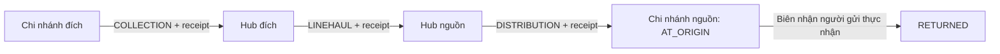
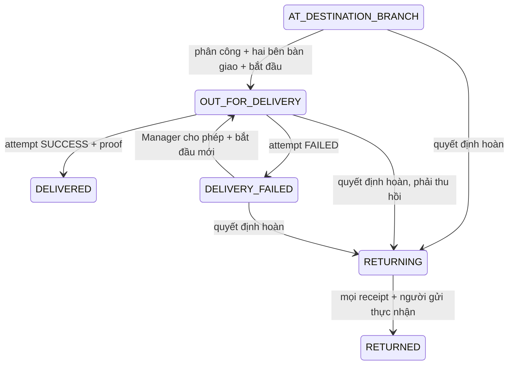

# Commit 13 — Giao chặng cuối, giao lại và hoàn hàng

Phụ trách An; nhánh `feature/an-last-mile-delivery`. Working tree sạch trước khi triển khai;
HEAD ban đầu `b0309c1` đã có Commit 01–12, bản sửa thiếu source Commit 11 và V7.
Không stage, commit, push, stash, merge hoặc tạo PR. Không sửa V1–V7, pom.xml, application.properties,
cấu hình kết nối hoặc SMTP. Không chạy ứng dụng/migration trên SQL Server thật trong lần triển khai này.

## 1. Tái sử dụng và phạm vi

Tái sử dụng Shipment, ShipmentAssignment loại DELIVERY, DeliveryAttempt, ShipmentEvent, Branch,
Employee, User, ManagerBranch, LogisticsAccessService, ShipmentTransitionPolicy và khóa Shipment hiện có.
Không có ShipmentEventType trong source: sự kiện vẫn dùng from/to status, title, description, actor, branch và UTC.
Không tạo kho hoặc bộ vận chuyển hoàn thứ hai: CENTRAL_HUB/LOCAL_BRANCH và TransportTrip V7 là mô hình chung.
Không thay giá, quote snapshot, COD, HOME_PICKUP, BRANCH_DROPOFF, OTP, đăng nhập hoặc Guest Tracking.

## 2. Phân công và hai bên bàn giao

Manager có ManagerBranch tại chi nhánh đích ACTIVE mới phân công được. Trạng thái AT_DESTINATION_BRANCH
chưa đủ: currentBranch phải đúng đích và có TripReceipt đi xuôi thực nhận tại đích. Đơn cùng chi nhánh
cần ShipmentIntake nguồn và sự kiện phân loại chính xác của Commit 12. Đơn cũ thiếu ShipmentMethod/bằng chứng
không được tự suy diễn đã nhận; cần đối soát có thẩm quyền, không backfill giả.

Employee nhận việc phải ACTIVE, COURIER_DRIVER, đúng chi nhánh, User ACTIVE và có ROLE_SHIPPER trong database.
Một kiện chỉ có một DELIVERY ASSIGNED/IN_PROGRESS. Manager chọn employeeId nhưng server tra lại toàn bộ điều kiện.
Phân công lại chỉ trước thực nhận, khác Shipper, có lý do; đóng assignment cũ CANCELLED, giữ lịch sử và hủy biên bản PREPARED.

1. Manager đồng thời có Employee DISPATCHER/WAREHOUSE_STAFF tại đích chuẩn bị xuất kiện, lưu người/nhân viên/tham chiếu/thời gian.
2. Shipper được phân công độc lập xác nhận đã thực nhận; actor và Employee không được trùng bên chuẩn bị.
3. Lúc thực nhận, assignment IN_PROGRESS, dispatch ACCEPTED, currentBranch NULL. Shipment giữ mốc tới đích/giao thất bại
   cho đến khi Shipper bấm bắt đầu lần giao; trạng thái cuối cùng không tự đại diện cho vị trí vật lý.
4. Bắt đầu hợp lệ mới tạo OUT_FOR_DELIVERY, dispatch STARTED và startedAt. Chưa tạo DeliveryAttempt thành công/thất bại.

## 3. Giao thành công và bằng chứng

Shipper của assignment đang giữ kiện, dispatch STARTED và Shipment OUT_FOR_DELIVERY mới ghi kết quả.
Cần xác nhận thực tế, loại người nhận RECIPIENT/FAMILY/AUTHORIZED_REP, tên thực nhận và tham chiếu không rỗng.
Trong một transaction: ghi DeliveryAttempt SUCCESS, tăng bộ đếm, ghi DeliveryProof, đóng assignment COMPLETED,
dispatch COMPLETED, lưu deliveredAt và Shipment DELIVERED, ShipmentEvent. Không có endpoint sửa/xóa biên nhận đã xác nhận.

DeliveryProof liên kết Shipment, assignment, attempt, User, Employee, loại/tên người nhận, tham chiếu, ghi chú và UTC.
Đây là lời xác nhận có cấu trúc do Shipper nhập, **không phải** chữ ký số, ảnh POD, OTP người nhận hoặc xác minh GPS.
recipientSignature/photoProofUrl cũ không được điền giả. Không xác nhận thu COD hoặc thu tiền.

## 4. Thất bại và trách nhiệm giữ kiện

Các mã lý do: UNREACHABLE (không liên hệ), ABSENT (vắng mặt), REFUSED (từ chối), INVALID_ADDRESS,
OPERATIONAL và DAMAGED. Phải có lý do cụ thể, xác nhận đã thử giao; mỗi kết quả có thứ tự, assignment, actor,
Employee, startedAt và attemptTime. Một lần bắt đầu chỉ ghi một kết quả; không ghi thành công rồi ghi thất bại cùng lần.

Thất bại đổi Shipment DELIVERY_FAILED và dispatch FAILED, nhưng assignment vẫn IN_PROGRESS/currentBranch NULL:
Shipper tiếp tục chịu trách nhiệm kiện. Không tự tạo intake, recovery receipt hoặc sự kiện giao thành công.

## 5. Chính sách giao lại

Chính sách lấy từ `shipments.max_delivery_attempts` hiện có (DEFAULT V1 là 3), tính cả lần thành công và thất bại.
Không hardcode giới hạn mới. Mỗi lần ghi/cho phép giao phải kiểm tra COUNT lịch sử = MAX attemptNumber =
deliveryAttemptCount, chưa đạt giới hạn. Dữ liệu lịch sử lệch bộ đếm bị chặn để đối soát, không tự sửa.

Chỉ Manager chi nhánh đích cho phép, lưu RedeliveryDecision với lý do, người, thời điểm, số lần vừa thất bại.
Mỗi số lần thất bại chỉ có một quyết định giao lại. Shipper không tự khởi động lại vô hạn.

- Kiện còn trên tay: SAME_COURIER, giữ assignment; dispatch về ACCEPTED, xóa startedAt hiện tại rồi Shipper bắt đầu lần mới.
  startedAt của lần trước đã được chụp trên DeliveryAttempt, lịch sử và sự kiện giữ nguyên.
- Đổi Shipper: phải có yêu cầu thu hồi và biên nhận chi nhánh độc lập thực nhận; đóng assignment cũ FAILED.
  Sau đó Manager quyết định NEW_ASSIGNMENT, chọn Shipper hợp lệ; vẫn phải chuẩn bị bàn giao/thực nhận mới.
- Hết lượt: không cho giao lại, Manager có thể quyết định hoàn. UI không thay chính sách database.

## 6. Thu hồi và yêu cầu hoàn

Shipper sau thất bại hoặc yêu cầu thu hồi tạo DeliveryRecovery PENDING; việc gửi yêu cầu không thay vị trí kiện.
Manager/Employee tiếp nhận tại đích phải khác actor/Employee của Shipper. RECEIVED cần xác nhận thực nhận và mã biên nhận;
REJECTED cần lý do, không được đánh dấu đã nhận. Từ chối giữ kiện trên tay, cho phép yêu cầu lại có lịch sử.
Nhận thành công mới currentBranch = đích, dispatch BRANCH_RETURNED và đóng assignment.

Manager khởi tạo ReturnRequest có lý do ở AT_DESTINATION_BRANCH/OUT_FOR_DELIVERY/DELIVERY_FAILED;
không cho vận đơn đã DELIVERED, yêu cầu hoàn trùng hoặc manifest đang giữ. Từ lúc có yêu cầu hoàn,
mọi accept/start/complete/fail/redelivery bị khóa. Không có nút hủy yêu cầu hoàn trong phạm vi này.

- Kiện ở chi nhánh có bằng chứng: hủy nhiệm vụ chưa nhận, READY_FOR_TRANSPORT (AT_ORIGIN nếu cùng chi nhánh).
- Kiện ở Shipper: REQUESTED, dispatch RECALL_REQUIRED (hoặc giữ RECOVERY_REQUESTED đang chờ).
  Chỉ sau khi Shipper gửi yêu cầu và chi nhánh độc lập nhận lại mới READY_FOR_TRANSPORT.

## 7. Tuyến hoàn thực tế qua hub



Đường hoàn là đảo thứ tự các điểm snapshot của Shipment, nhưng **mỗi hướng tuyến phải có transport_routes ACTIVE thật**.
Không tự tạo tuyến hoặc coi tuyến đi có sẵn là tuyến về. Hub dùng chung chỉ có hai chặng; cùng chi nhánh không tạo chuyến giả.
ParentHub hiện hành phải khớp snapshot; cấu hình thiếu/thay đổi chặn xuất, không đoán hub.

TransportTripItem có return_request_id, UI phân biệt kiện/chặng hoàn và chuyển đi. Trip có thể chứa kiện đi/hoàn
nếu cùng cặp điểm hợp lệ; mỗi item giữ hướng riêng. Vẫn dùng lập manifest, niêm phong, xuất, đến, kiểm nhận,
discrepancy và đóng chuyến của Commit 12. Giữ chỗ đúng chuyến được kiểm lại khi seal/depart; giữ chỗ chuyến khác bị chặn.

Xuất chuyến: ReturnStage IN_TRANSIT, currentBranch NULL, Shipment vẫn RETURNING.
Đến chuyến chưa có nghĩa nhận kiện. Chỉ TripReceipt thực nhận mới cập nhật điểm, nhả giữ chỗ và READY_FOR_TRANSPORT
cho chặng kế; thiếu/hỏng/từ chối dùng discrepancy V7. Chưa receipt không được đi tiếp hoặc trả người gửi.
Tới nguồn: ReturnStage AT_ORIGIN, Shipment vẫn RETURNING, returnedAt NULL.

## 8. Biên nhận trả người gửi

Chỉ Manager có ManagerBranch và Employee tiếp nhận hợp lệ tại **chi nhánh nguồn** thực hiện được,
không phải Manager đích mặc nhiên được quyền. Operator không được là User người gửi tự xác nhận cho mình.
Cần kiện thực ở nguồn, receipt chặng hoàn cuối (trừ cùng chi nhánh), không assignment/chuyến xung đột;
xác nhận thực giao, loại SENDER/AUTHORIZED_REP, tên và mã tham chiếu.

ReturnReceipt chỉ một cho ReturnRequest. Transaction ghi biên nhận, ReturnStage COMPLETED/completedAt,
Shipment RETURNED/returnedAt/currentBranch NULL và sự kiện. Chỉ về kho không được RETURNED.
Chưa triển khai trả tận nhà hoặc nhận dạng tự động đại diện; nhân viên kiểm tra thực tế và ghi nhận có cấu trúc.

## 9. State machine và lịch sử



Không thêm ShipmentStatus. Chi tiết PREPARED/ACCEPTED/STARTED/FAILED/RECOVERY_REQUESTED/BRANCH_RETURNED/
RECALL_REQUIRED/COMPLETED/CANCELLED nằm trên DeliveryDispatch; tiến trình hoàn nằm trên ReturnStage.
Mọi thao tác nghiệp vụ, kể cả giữ nguyên ShipmentStatus, có ShipmentEvent với actor và UTC.
Generic ShipmentLifecycleService không mở quyền đổi trạng thái giao/hoàn, không bỏ qua chứng cứ.
Assignment cũ không xóa; quyết định, attempt, dispatch, recovery, trip receipt và final receipt đều được giữ để audit.

## 10. Routes thực tế

| Vai trò | Method | Route |
|---|---|---|
| Manager | GET | `/manager/deliveries` (status, tracking chính xác, page) |
| Manager | GET | `/manager/deliveries/{shipmentId}` (page lịch sử/ứng viên) |
| Manager | POST | `/manager/deliveries/{shipmentId}/assign`, `/reassign` |
| Manager | POST | `/manager/deliveries/{shipmentId}/handoff` |
| Manager | POST | `/manager/deliveries/{shipmentId}/redelivery`, `/return` |
| Manager | POST | `/manager/deliveries/{shipmentId}/recoveries/accept`, `/recoveries/reject` |
| Manager nguồn | POST | `/manager/deliveries/{shipmentId}/return-to-sender` |
| Shipper | GET | `/shipper/deliveries`, `/shipper/deliveries/{assignmentId}` |
| Shipper | POST | `/shipper/deliveries/{assignmentId}/accept`, `/start`, `/complete`, `/fail`, `/return-to-branch` |
| Manager tuyến | GET/POST | `/manager/trips/**` và `/manager/trips/shipments/{shipmentId}/history` giữ Commit 12 |

Các hậu tố rút gọn trong cùng ô dùng đầy đủ prefix ở đầu ô. Không dùng GET ghi dữ liệu.
Danh sách, lịch sử và ứng viên phân trang 20; form không tin version/ID hoặc số tiền client mà không kiểm tra lại.

## 11. Security và riêng tư

Prefix SecurityConfig hiện có + method security + guard tra User/role/Employee/ManagerBranch thật trong database.
ADMIN không tự kế thừa MANAGER/SHIPPER. Manager đích chỉ thấy kiện đúng phạm vi; Manager nguồn thấy yêu cầu hoàn
để nhận trả. Manager từng điểm chỉ xem trip/history theo phạm vi V7, không mở quyền thấy mọi chặng.
Shipper tra assignment bằng ID + Employee của SecurityContext, sau đó kiểm tra lại khi ghi; ID trong URL không cấp quyền.
Assignment đã đóng/hủy vẫn xem lịch sử của chính mình, **không hiển thị contact người nhận**; Shipper khác không xem được.

POST dùng CSRF Thymeleaf, DTO/form allowlist và validation server. Actor không bind từ form; ID route là nguồn command.
Lỗi stale version/persistence không báo thành công; dữ liệu nhập hiển thị bằng th:text để escape HTML.
Guest chỉ đọc PublicTrackingView hiện có; whitelist sự kiện chính xác vẫn chỉ tuple CREATED đã duyệt.
Không công khai title/description nội bộ, tên người nhận thực tế, tham chiếu, thất bại, Employee hoặc biên nhận qua Guest Tracking.
USER chỉ xem đơn của chính mình theo Commit 06; không thêm endpoint nội bộ cho USER.

## 12. Transaction và cạnh tranh

LastMileService là nơi ghi tập trung, mỗi thao tác @Transactional; khóa Shipment PESSIMISTIC_WRITE trước khi đọc/mutate
assignment/dispatch/attempt/recovery/return, so expectedVersion và @Version. Shipper chỉ tra scalar shipmentId trước khóa;
sau khi chờ khóa phải đọc lại assignment có hiệu lực. Cập nhật updatedAt cả khi trạng thái không đổi để version tiến lên.
Transport giữ thứ tự Trip → Shipment tăng dần → dữ liệu con của Commit 12; last-mile không khóa Trip ngược chiều.

Các hàng nghiệp vụ, counter, trạng thái và sự kiện cùng transaction. V8 UNIQUE/filtered unique bảo vệ active DELIVERY,
attempt SUCCESS, proof, pending/received recovery, quyết định retry, return request và final receipt.
Hai request dùng cùng version không cùng hoàn tất; giao thành công và thất bại/quyết định hoàn loại trừ nhau dưới khóa parent.
SQL Server cần kiểm chứng riêng lock, isolation, FK/CHECK/unique và JDBC rollback; mock không chứng minh các điều này.

## 13. Migration V8 và tương thích

`V8__add_last_mile_delivery_and_returns.sql` tạo sáu bảng: delivery_dispatches, delivery_proofs,
delivery_recoveries, redelivery_decisions, return_requests, return_receipts; tất cả có FK NO ACTION,
CHECK enum/text/độc lập, UNIQUE và index theo truy vấn.

Mở rộng delivery_attempts bằng assignment_id, actor_id, failure_code, started_at;
shipments bằng delivered_at/returned_at; transport_trip_items bằng return_request_id.
Các cột mới trên bảng cũ NULL để bảo toàn dữ liệu cũ; không tạo chứng cứ, gán phương thức hoặc timestamp giả.
CHECK context cho phép attempt legacy toàn bộ trường mới NULL; dòng mới phải có đủ ngữ cảnh.
Các timestamp mới chỉ hợp lệ với status cuối tương ứng; status legacy không bắt buộc được backfill timestamp.

V8 kiểm tra trước duplicate active DELIVERY/success attempt và THROW để yêu cầu đối soát, không tự xóa/sửa lịch sử.
JPA dùng LAZY, VARCHAR enum, NVARCHAR text, DATETIME2(7) UTC và không cascade remove/all/orphanRemoval.
Không thay số tiền, không thêm phí hoàn hoặc dữ liệu tuyến/nhân sự giả. Một ReturnRequest duy nhất cho mỗi Shipment là
chủ ý: luồng hoàn không có hủy/mở lại; muốn hỗ trợ sau này cần audit/quy tắc/migration riêng.

## 14. Kiểm thử và giới hạn xác minh

Kết quả kiểm tra cuối cùng được ghi trong mục kết quả bên dưới sau khi chạy toàn bộ suite.
Test mới dùng service/guard thật với repository Mockito, MVC/filter/template thật và method-security Spring thật.
Test transaction chạy Spring TransactionInterceptor, kiểm tra quyết định commit/rollback; test cạnh tranh dùng mô hình
ReentrantLock tại parent và hai thread. Không mô phỏng row rollback rồi tuyên bố đã chứng minh JDBC.
CoreDatabaseMappingTests khởi tạo Hibernate offline, kiểm tra mapping/schema SQL và tạo Spring Data Repository để kiểm tra JPQL.
Không có datasource thật được bật trong các test web; không chạy migration hoặc đổi SQL Server thật.

Kiểm thử thủ công có chủ đích trong môi trường được phép:

1. Review/backup dữ liệu, kiểm tra các điều kiện preflight V8, cấu hình tuyến ngược/ManagerBranch/Employee hợp lệ qua quy trình vận hành.
2. Chạy migration V8 và Hibernate validate trên **database test được phê duyệt**; không sửa V1–V7 hoặc coi test offline là validate JDBC.
3. Tạo HOME_PICKUP và BRANCH_DROPOFF theo UI cũ; hoàn tất từng bước nguồn/chuyến tới receipt thực ở đích.
4. Mở `/manager/deliveries`, lọc mã; chọn Shipper, thử phân công lại trước nhận, chuẩn bị biên bản.
5. Đăng nhập Shipper độc lập, mở `/shipper/deliveries`; nhận kiện, bắt đầu, kiểm tra chưa có attempt kết quả.
6. Ghi SUCCESS có đủ thông tin; kiểm tra proof, timestamp, fee snapshot, double-submit và session khác không sửa được.
7. Với kiện khác ghi FAILED; kiểm tra kiện còn ở Shipper, không tự restart. Manager cho retry; thử đến giới hạn database.
8. Gửi thu hồi; thử từ chối rồi gửi lại. Chỉ biên nhận chấp nhận độc lập mới chuyển kiện về chi nhánh và cho đổi Shipper.
9. Khởi tạo hoàn khi đang giao; thử complete/retry bị chặn. Thu hồi thực nhận, lập từng chuyến ngược, thử thiếu receipt/discrepancy.
10. Tới nguồn kiểm tra vẫn RETURNING/AT_ORIGIN. Manager nguồn lưu final receipt thực nhận mới RETURNED; thử xác nhận lặp.
11. Hai trình duyệt dùng cùng version: phân công/nhận/giao thành công/thất bại/hoàn cạnh tranh; kiểm tra JDBC transaction và không có sự kiện mồ côi.
12. Kiểm tra điện thoại, CSRF, URL của người khác, tài khoản bị khóa/thu hồi role, Guest Tracking không lộ dữ liệu nội bộ.

Chưa có trả tận nhà, tuyến đồ thị nhiều hub ngoài snapshot, hủy/cải chính biên nhận, quản trị policy/tuyến trong UI,
OTP/ảnh/chữ ký/GPS POD, COD, thu phí hoàn, thanh toán, SMS hoặc WebSocket. Các bước tiếp theo cần thiết kế audit,
retention/chính sách quyền xem proof và kiểm thử tích hợp SQL Server thật trước vận hành.

## 15. Kết quả kiểm tra ngày 23/10/2026

- `./mvnw.cmd clean test`: BUILD SUCCESS, 637 test, 636 đạt, 0 failure, 0 error, 1 skipped.
- Test bỏ qua: UteexpressApplicationTests tích hợp SQL Server opt-in, chưa bật môi trường database thật.
- `./mvnw.cmd -DskipTests compile`: BUILD SUCCESS trên Java 21.0.2.
- `git diff --check`: đạt; đã kiểm tra branch, status, diff stat và toàn bộ untracked.
- Test mới: LastMileServiceTests 66, DeliveryTransactionTests 15, DeliveryFlowTests 24; tổng 105.
  PublicTrackingServiceTests mở rộng thêm 5 trường hợp trạng thái, tổng suite tăng 110 so với baseline 527.
- Method-security test hiện có mở rộng các thao tác giao/hoàn; Hibernate offline kiểm tra 36 Entity/Repository.
- Cảnh báo build: metadata repository Flyway GitHub trả HTTP 401 nhưng dependency build/test vẫn có và build đạt;
  Mockito/ByteBuddy tự gắn Java agent; Hibernate offline không đọc JDBC metadata và cảnh báo dialect cấu hình tường minh.
  Javac có cảnh báo unchecked trong test Mockito (LastMileServiceTests).
  Không sửa dependency/cấu hình để che các cảnh báo này.
- **Chưa kiểm thử SQL Server thật:** V8 chưa apply, chưa chạy Hibernate ddl-auto=validate trên database,
  chưa xác minh FK/CHECK/filtered unique hoặc concurrency/transaction rollback JDBC thực tế.
- Thymeleaf đã render qua MockMvc; chưa có kiểm tra trực quan trên trình duyệt/thiết bị thật với dữ liệu vận hành.

Danh sách file dưới đây lấy trực tiếp từ Git sau triển khai. File mới vẫn untracked theo yêu cầu không git add;
cần đưa đủ các file này vào lần commit do người dùng thực hiện, tránh lặp lỗi thiếu source của Commit 11.

### File mới / untracked

39 files.

```text
docs/last-mile-delivery.md
src/main/java/com/ute/uteexpress/controller/ManagerDeliveryController.java
src/main/java/com/ute/uteexpress/controller/ShipperDeliveryController.java
src/main/java/com/ute/uteexpress/dto/delivery/DeliveryCommands.java
src/main/java/com/ute/uteexpress/dto/delivery/DeliveryForms.java
src/main/java/com/ute/uteexpress/dto/delivery/DeliveryLabels.java
src/main/java/com/ute/uteexpress/dto/delivery/DeliveryViews.java
src/main/java/com/ute/uteexpress/entity/DeliveryDispatch.java
src/main/java/com/ute/uteexpress/entity/DeliveryProof.java
src/main/java/com/ute/uteexpress/entity/DeliveryRecovery.java
src/main/java/com/ute/uteexpress/entity/RedeliveryDecision.java
src/main/java/com/ute/uteexpress/entity/ReturnReceipt.java
src/main/java/com/ute/uteexpress/entity/ReturnRequest.java
src/main/java/com/ute/uteexpress/enums/DeliveryDispatchStatus.java
src/main/java/com/ute/uteexpress/enums/DeliveryFailureCode.java
src/main/java/com/ute/uteexpress/enums/DeliveryRecipientType.java
src/main/java/com/ute/uteexpress/enums/DeliveryRecoveryStatus.java
src/main/java/com/ute/uteexpress/enums/RedeliveryMode.java
src/main/java/com/ute/uteexpress/enums/ReturnRecipientType.java
src/main/java/com/ute/uteexpress/enums/ReturnStage.java
src/main/java/com/ute/uteexpress/repository/DeliveryDispatchRepository.java
src/main/java/com/ute/uteexpress/repository/DeliveryProofRepository.java
src/main/java/com/ute/uteexpress/repository/DeliveryRecoveryRepository.java
src/main/java/com/ute/uteexpress/repository/RedeliveryDecisionRepository.java
src/main/java/com/ute/uteexpress/repository/ReturnReceiptRepository.java
src/main/java/com/ute/uteexpress/repository/ReturnRequestRepository.java
src/main/java/com/ute/uteexpress/service/DeliveryCustodyService.java
src/main/java/com/ute/uteexpress/service/DeliveryReadService.java
src/main/java/com/ute/uteexpress/service/LastMileService.java
src/main/resources/db/migration/V8__add_last_mile_delivery_and_returns.sql
src/main/resources/templates/delivery/fragments.html
src/main/resources/templates/delivery/manager-detail.html
src/main/resources/templates/delivery/manager-list.html
src/main/resources/templates/delivery/shipper-detail.html
src/main/resources/templates/delivery/shipper-list.html
src/test/java/com/ute/uteexpress/delivery/DeliveryScenario.java
src/test/java/com/ute/uteexpress/delivery/DeliveryTransactionTests.java
src/test/java/com/ute/uteexpress/delivery/LastMileServiceTests.java
src/test/java/com/ute/uteexpress/security/DeliveryFlowTests.java
```

### File đã sửa

28 files.

```text
docs/logistics-core.md
docs/manager-logistics.md
docs/shipper-pickup.md
docs/transport-hub.md
src/main/java/com/ute/uteexpress/dto/transport/TripViews.java
src/main/java/com/ute/uteexpress/entity/DeliveryAttempt.java
src/main/java/com/ute/uteexpress/entity/Shipment.java
src/main/java/com/ute/uteexpress/entity/TransportTripItem.java
src/main/java/com/ute/uteexpress/repository/DeliveryAttemptRepository.java
src/main/java/com/ute/uteexpress/repository/ShipmentAssignmentRepository.java
src/main/java/com/ute/uteexpress/repository/ShipmentEventRepository.java
src/main/java/com/ute/uteexpress/repository/TransportTripItemRepository.java
src/main/java/com/ute/uteexpress/repository/TripReceiptRepository.java
src/main/java/com/ute/uteexpress/service/ShipmentTransitionPolicy.java
src/main/java/com/ute/uteexpress/service/TransportRouting.java
src/main/java/com/ute/uteexpress/service/TransportTripReadService.java
src/main/java/com/ute/uteexpress/service/TransportTripService.java
src/main/resources/templates/manager/fragments.html
src/main/resources/templates/shipper/dashboard.html
src/main/resources/templates/shipper/fragments.html
src/main/resources/templates/transport/detail.html
src/main/resources/templates/transport/history.html
src/test/java/com/ute/uteexpress/CoreDatabaseMappingTests.java
src/test/java/com/ute/uteexpress/security/LogisticsServiceSecurityTests.java
src/test/java/com/ute/uteexpress/security/SecurityConfigTests.java
src/test/java/com/ute/uteexpress/security/TransportTripFlowTests.java
src/test/java/com/ute/uteexpress/service/PublicTrackingServiceTests.java
src/test/java/com/ute/uteexpress/service/TransportTripServiceTests.java
```
