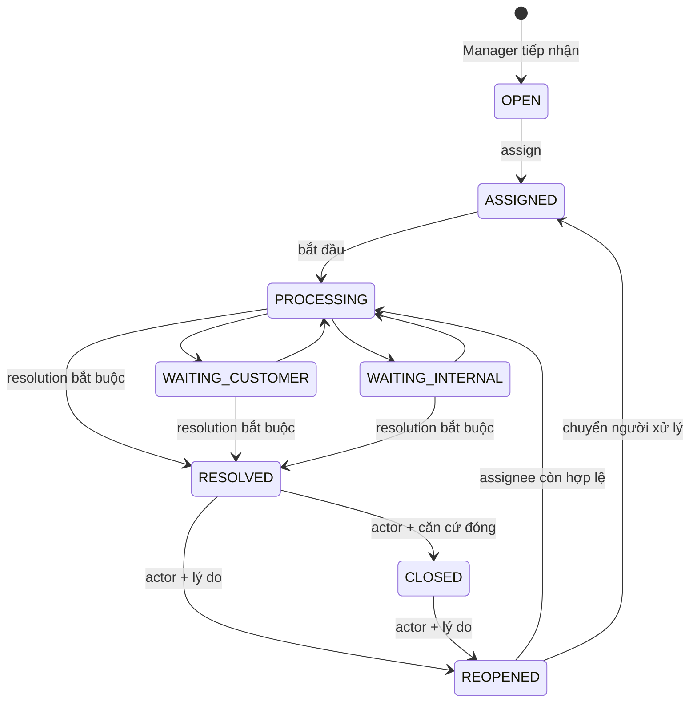

# Commit 16 — Operations Dashboard & Complaint Ticket Management

Phụ trách: An. Nhánh: `feature/an-operations-dashboard-tickets`.

Đầu phiên: working tree sạch, HEAD `f4ed5f1` là merge Commit 15 (`c6452c8`), nối tiếp lịch sử Commit 01–14 và các bản sửa đã có trên main. Baseline chạy thực tế: **801 tests, 800 passed, 0 failures/errors, 1 skipped**. Không thay đổi Git index/lịch sử, không stage/commit/push/merge/stash/PR.

## 1. Phạm vi và các thành phần tái sử dụng

Tái sử dụng Shipment, ShipmentEvent, ShipmentAssignment, ShipmentIntake, pickup/handoff, TransportTrip/Item, TripReceipt, TripDiscrepancy, DeliveryAttempt/Proof/Dispatch/Recovery, ReturnRequest/Receipt, User/Employee/ManagerBranch, TicketPriority, SupportTicket, Notification và WebSocket của Commit 15.

`support_tickets` đã có từ V1, với User, Shipment optional, assigned_manager, status OPEN/PROCESSING/RESOLVED/CLOSED, priority, subject/content/resolution_notes và timestamps. Chưa có UI/service xử lý ticket trước Commit 16. Mở rộng root này, không tạo root ticket trùng chức năng. Giữ nguyên tên PROCESSING và dữ liệu legacy. Không đổi ShipmentStatus hoặc bất kỳ lifecycle, giá/fee snapshot nào.

Manager `/manager` cũ vẫn là màn hình tiếp nhận ở **chi nhánh nguồn**. Dashboard mới `/manager/operations` được nối vào navigation và màn hình cũ, phục vụ đọc KPI đa công đoạn. Hai màn hình có vai trò rõ ràng; không thay định nghĩa thống kê cũ âm thầm.

## 2. Quyền và phạm vi chi nhánh

`OperationsAccessService` tái sử dụng LogisticsAccessService.requireManager: authority ROLE_MANAGER trên session **và** role thật trong database, User ACTIVE. Bổ sung Employee liên kết đúng User, ACTIVE, có chi nhánh ACTIVE. Không coi ADMIN/USER/SHIPPER là Manager. Employee không nhất thiết có home branch trùng mọi chi nhánh được ManagerBranch cấp quyền đọc.

Mỗi lần xem dashboard/ticket phải chọn **một** chi nhánh ACTIVE từ ManagerBranch hiện tại. Nếu không truyền branchId, dùng chi nhánh hợp lệ đầu tiên; nếu không có chi nhánh, UI hiển thị empty scope. Không có phép tổng hợp OR origin/destination dùng cho mọi KPI. Chọn từng chi nhánh tránh lặp dữ liệu khi một shipment vừa có nguồn vừa có đích thuộc cùng Manager.

Mọi query dashboard có GATE kiểm tra lại ManagerBranch, User ACTIVE, ROLE_MANAGER và Employee ACTIVE/home branch ACTIVE ở DB. Service kiểm tra scope trước và sau khi đọc. Các query đọc READ_COMMITTED, không lấy khóa ghi hay dùng isolation cao cho báo cáo. Dashboard gồm nhiều query nên không phải snapshot nguyên tử toàn hệ thống; các số current-state có thể thay đổi giữa các câu truy vấn khi giao nhận diễn ra.

Ticket có **handling_branch_id** làm chi nhánh chịu trách nhiệm chính. Scope ticket dựa vào chi nhánh này, không lấy query parameter của client để cấp quyền. Service đọc/ghi xác minh User/Employee/role/membership thật. ID ngoài scope trả 404; branch được chọn ngoài scope trả 403. Repo lockManaged lọc membership và service xác minh lại sau khi lấy khóa.

Một ticket mới phải gắn vận đơn mà chi nhánh tiếp nhận là nguồn, đích hoặc currentBranch. Điều kiện này chỉ xác lập quan hệ để tiếp nhận ticket; không cấp quyền xem toàn bộ contact/fee/timeline shipment ở module khác. DTO ticket chỉ thêm tracking number và ShipmentStatus, không contact/COD/giá. Các route nghiệp vụ gốc vẫn có guard riêng.

## 3. Bộ lọc, Clock và cách hiểu thời gian

- Toàn bộ timestamp DB là UTC DATETIME2(7); thời gian service tạo cắt về 100ns. UI ghi rõ UTC.
- Preset TODAY, LAST_7_DAYS, LAST_30_DAYS dùng cùng Clock injected, ngày UTC. CUSTOM cần đủ from/to.
- UI nhập ngày kết thúc **bao gồm cả ngày đó**; backend chuyển sang `[from.atStartOfDay(), to.plusDays(1).atStartOfDay())`.
- Giới hạn 93 ngày bao gồm hai đầu; from <= to; không chọn tương lai hoặc năm ngoài miền DATETIME2. Invalid filter trả 400 thân thiện.
- Dropdown status chỉ lọc **cohort đơn nguồn tạo trong kỳ** và biểu đồ ngày của cohort đó. Không đổi mẫu số kết quả giao thực tế trong kỳ.
- WorkGroup chọn bảng công việc CONFIRM/PICKUP/INTAKE/DISPATCH/DELIVERY/FAILED/RETURNS. Các hàng tồn hiện tại không bị cắt bởi ngày tạo đã chọn, để tránh bỏ sót kiện cũ.
- Báo cáo có transaction read-only timeout 15 giây, query hint timeout 5 giây. Không tự thay DB READ_COMMITTED_SNAPSHOT hoặc cấu hình SQL Server.

## 4. KPI và công thức

### Cohort tạo trong kỳ

| Chỉ số | Phạm vi | Ngày và định nghĩa |
|---|---|---|
| Tổng đơn phát sinh nguồn | originBranch = chi nhánh | createdAt trong kỳ, optional status; mỗi shipment một lần |
| Nhóm trạng thái cohort | Cùng cohort nguồn | GROUP BY Shipment.status hiện tại: CREATED, CONFIRMED, PICKUP_ASSIGNED, PICKED_UP, AT_ORIGIN_BRANCH, AT_ORIGIN_HUB, IN_TRANSIT, AT_DESTINATION_HUB, AT_DESTINATION_BRANCH, OUT_FOR_DELIVERY, DELIVERED, DELIVERY_FAILED, RETURNING, RETURNED, CANCELLED |
| Đơn nguồn theo ngày | Cùng cohort nguồn | GROUP BY cast(createdAt as LocalDate), UTC, lấp ngày không có đơn bằng 0 |
| Đơn có đích tại đây | destinationBranch = chi nhánh | createdAt trong kỳ, độc lập với cohort nguồn; không cộng hai số thành tổng |
| Ticket theo trạng thái | handlingBranch = chi nhánh | Ticket.createdAt trong kỳ, GROUP BY status hiện tại |

Tổng các nhóm trạng thái loại trừ nhau bằng tổng cohort tương ứng. Một shipment nguồn=đích có thể xuất hiện ở hai **chỉ số có phạm vi khác nhau**, mỗi chỉ số chỉ đếm một lần; không cộng gộp chúng.

### Kết quả thực tế trong kỳ

| Chỉ số | Phạm vi và mốc | Điều kiện |
|---|---|---|
| Thực nhận tại nguồn | ShipmentIntake.branch; receivedAt trong kỳ | Biên nhận thực tế, một intake/Shipment theo schema |
| Giao thành công tại đích | Shipment.destinationBranch; DeliveryProof.deliveredAt trong kỳ | Shipment DELIVERED, proof khớp shipment/assignment/employee/actor và thời gian, attempt SUCCESS có startedAt, không suy từ assignment |
| Lần giao thành công | DestinationBranch; attemptTime trong kỳ | Attempt SUCCESS, Shipment DELIVERED, assignment DELIVERY/employee khớp, actor/startedAt, time >= startedAt và proof tương ứng |
| Lần giao thất bại | Cùng phạm vi/mốc attemptTime | Attempt FAILED có assignment/actor/startedAt, failureCode và kết quả hợp lệ |
| Đơn có lần giao thất bại | Cùng tập failed attempts | COUNT(DISTINCT shipment_id), không lấy số lần làm số đơn |
| Lý do thất bại | Cùng tập failed attempts | GROUP BY failureCode; không phát lộ failureReason tự do |
| Yêu cầu hoàn | Shipment.destinationBranch; requestedAt trong kỳ | ReturnRequest, không coi là đã hoàn tất trả |
| Thực trả người gửi | ReturnReceipt.branch = Shipment.originBranch; receivedAt trong kỳ | Shipment RETURNED và ReturnRequest.stage=COMPLETED, có receipt thực tế |

**Tỷ lệ lần giao thành công = SUCCESS có proof / (SUCCESS có proof + FAILED hợp lệ) × 100%.** Một shipment có 3 lần FAILED rồi 1 SUCCESS cho tỷ lệ 25%, số shipment có failed là 1. Không chia cho toàn bộ đơn tạo. Mẫu số 0 hiển thị **N/A**.

**Tỷ trọng hoàn trong kết quả cuối của đơn nguồn = RETURNED có receipt / (RETURNED có receipt + DELIVERED có proof của đơn nguồn) × 100%.** Hai tập cùng originBranch, theo thời điểm kết quả cuối trong kỳ, không phải cohort ngày tạo. Chỉ số này không phải tỷ lệ hoàn trên mọi đơn tạo hoặc ReturnRequest. Pending và CANCELLED không vào mẫu số. Không mẫu số => N/A.

### Snapshot công việc/custody hiện tại

| Chỉ số | Phạm vi và điều kiện |
|---|---|
| Đang giữ | currentBranch = chọn; chưa DELIVERED/RETURNED/CANCELLED, có intake/trip receipt hoặc recovery RECEIVED tại điểm đó |
| Tại đích chờ giao | destination=currentBranch=chọn, AT_DESTINATION_BRANCH, có chứng từ custody như trên |
| Đang giao | destinationBranch=chọn, OUT_FOR_DELIVERY, DeliveryDispatch STARTED có acceptedAt và startedAt |
| Phân công đang hoạt động | PICKUP thuộc origin hoặc DELIVERY thuộc destination, status ASSIGNED/IN_PROGRESS; không suy TRANSFER từ enum cũ |
| Chặng đã xuất từ đây, chưa kiểm nhận | TripItem active, trip.origin=chọn, departedAt có thật, trip DEPARTED/RECONCILING, chưa TripReceipt; COUNT DISTINCT shipment |
| Xe đã tới đây, kiện chờ kiểm nhận | TripItem active, trip.destination=chọn, RECONCILING, chưa TripReceipt; vehicle arrival không tự tạo parcel receipt |
| Discrepancy chưa giải quyết | trip.destination=chọn, TripDiscrepancy OPEN |
| Ticket mới chưa phân công | handlingBranch=chọn, OPEN, assigned_manager NULL |
| Ticket giao cho tôi | handlingBranch=chọn, assigned_manager=current actor, chưa RESOLVED/CLOSED |
| Chờ khách | handlingBranch=chọn, WAITING_CUSTOMER |
| Ticket quá ngưỡng | warning_due_at < Clock.now, chưa RESOLVED/CLOSED; deadline NULL không bị đoán là quá hạn |

Các chỉ số custody/assignment/trip/ticket khác đối tượng và thời điểm, không cộng làm tổng vận đơn.

## 5. Thời gian xử lý và giới hạn lịch sử

Tất cả dùng `timestampdiff(second, start, end)` rồi AVG tại DB, kèm số mẫu; thời gian kết thúc nằm trong kỳ, loại mốc âm/thiếu. Độ phân giải giây, không cam kết độ chính xác dưới giây.

| Chỉ số | Start → End | Phạm vi |
|---|---|---|
| Chờ xác nhận | Shipment.createdAt → event CREATED→CONFIRMED có title thật | Chi nhánh nguồn, kỳ theo event.occurredAt |
| Xác nhận đến thực nhận nguồn | Event xác nhận duy nhất → ShipmentIntake.receivedAt | Intake.branch; nếu nhiều mốc xác nhận không xác định thì loại mẫu |
| Vận chuyển từng chặng/kiện | Trip.departedAt → TripReceipt.receivedAt | Receipt.branch; không gọi đây là thời gian end-to-end của shipment |
| Chờ giao tại đích | Arrival event AT_DESTINATION_BRANCH thật, duy nhất → event bắt đầu lần giao đầu tiên | DestinationBranch; chỉ title actual receipt hoặc phân loại cùng chi nhánh, không lấy assignment event |
| Từng lần giao | DeliveryAttempt.startedAt → attemptTime của lần có kết quả hợp lệ | DestinationBranch |
| Giải quyết ticket gần nhất | Ticket.createdAt → resolvedAt hiện tại | HandlingBranch; status RESOLVED/CLOSED; kỳ theo resolvedAt |

Ticket mở lại xóa resolvedAt/closedAt **hiện tại**, giữ toàn bộ lịch sử và public resolutions trước đó. Thời gian ticket là tổng tuổi kể từ tạo tới lần giải quyết gần nhất, có cả thời gian chờ; không phải giờ làm việc thực tế/SLA và không trừ các khoảng từng đóng. Legacy thiếu mốc không được tự backfill. Không đủ mẫu hiển thị N/A, không tự lấy updatedAt thay mốc nghiệp vụ.

## 6. Hàng tồn và cảnh báo có cấu hình

Bảng công việc theo nhóm, mỗi trang 20 dòng, sort createdAt/id tăng dần để thấy đơn cũ trước:

| Nhóm | Điều kiện chính | Link |
|---|---|---|
| CONFIRM | Origin, CREATED | Detail tiếp nhận nguồn |
| PICKUP | Origin, HOME_PICKUP, CONFIRMED/PICKUP_ASSIGNED | Detail nguồn |
| INTAKE | Origin, BRANCH_DROPOFF CONFIRMED hoặc HOME_PICKUP PICKED_UP, chưa intake | Detail nguồn |
| DISPATCH | Đang giữ có chứng từ; AT_ORIGIN_BRANCH/AT_ORIGIN_HUB/AT_DESTINATION_HUB; chưa active manifest | Lịch sử chuyến của kiện |
| DELIVERY | Destination, AT_DESTINATION_BRANCH, đang giữ, chưa assignment DELIVERY active | Detail delivery |
| FAILED | Destination, DELIVERY_FAILED có lần failed hiện tại, chưa decision cho lần đó và chưa ReturnRequest | Detail delivery |
| RETURNS | RETURNING có ReturnRequest chưa COMPLETED, currentBranch=chọn hoặc REQUESTED tại destination | Module giao cuối/hoàn |

Trip widget giới hạn 10 chuyến: DRAFT/SEALED ở origin để niêm phong/xuất; RECONCILING ở destination để kiểm nhận; hoặc có OPEN discrepancy tại destination. Link quay về module đã có object authorization. Vai trò ManagerBranch không tự cho phép thực hiện các thao tác vật lý yêu cầu Employee/điểm tiếp nhận của module gốc.

Ngưỡng **mặc định tắt**, không thêm giá trị tùy tiện vào application.properties:

- `uteexpress.operations.shipment-warning-age=PT0S`: khi >0, chỉ đếm các kiện trong nhóm đang chờ mà **tuổi đơn từ createdAt** vượt ngưỡng. Đây không phải thời gian riêng của từng stage. UI ghi đúng tiêu chí.
- `uteexpress.operations.ticket-warning-age=PT0S`: khi >0, snapshot `warning_due_at = createdAt + duration` lúc tạo ticket. Tính thời gian lịch liên tục, không tạm dừng WAITING_CUSTOMER. Không đổi deadline khi reply/classify/assign/reopen. Trạng thái RESOLVED/CLOSED không báo quá ngưỡng.
- Duration phải theo giây nguyên, từ 0 đến 365 ngày. Ví dụ người vận hành tự quyết định PT24H để ưu tiên nội bộ, không phải cam kết SLA. Đúng thời điểm deadline chưa là "quá"; chỉ `< now` mới tính.

Không có scheduled job cảnh báo quá hạn tự tạo notification lặp vô hạn.

## 7. Query, index và UI dashboard

`OperationsDashboardQueries` có catalog HQL cố định, named parameters, không nhận SQL/sort fragment từ client. DB thực hiện GROUP BY, COUNT DISTINCT, AVG; Java chỉ định dạng nhóm kết quả nhỏ và điền ngày thiếu. Không `findAll()` Shipment hoặc aggregate entity trong RAM. Work/trip lists dùng scalar projection, offset/limit, không tải contacts/fees. Read-only service riêng với write service. Không có tính doanh thu hay số tiền đã thu, không tính lại phí.

V11 thêm index cho branch/date cohort origin/destination, current custody, attemptTime/shipment/status, proof.deliveredAt/shipment, return requestedAt/shipment và receipts.branch/receivedAt; ticket branch/status/priority/created, branch/create và branch/resolved; timelines và pending event. Đây là thiết kế theo predicate/join/order trong query, **chưa** có actual execution plan, load test hoặc benchmark trên SQL Server lớn.

Tham khảo cú pháp cast/date/aggregate trong [Hibernate HQL 7](https://docs.jboss.org/hibernate/orm/7.0/querylanguage/html_single/Hibernate_Query_Language.html). Query được compile với SQLServerDialect offline và chạy thực tế bằng Hibernate/H2 trong test; không đồng nhất hai mức này với SQL Server execution.

UI Thymeleaf + Bootstrap hiện có, không thêm thư viện chart/CDN/framework. Sáu biểu đồ thanh nhẹ: ngày tạo đơn, trạng thái cohort, kết quả lần giao, failureCode, hoàn hàng, trạng thái ticket. Thanh dùng số nguyên do server tính, label escape, mỗi chart có bảng fallback luôn mở được, khu vực dài có scroll. Có empty/N/A/error và loading khi submit filter. JS chỉ hiển thị loading/reset khi back-forward cache, không tạo dữ liệu/random/aggregate phía trình duyệt.

## 8. V11 — schema và dữ liệu legacy

Migration duy nhất mới: **V11__add_operations_tickets.sql**. Không sửa V1–V10, không DML seed/backfill dữ liệu thật. V11 mở rộng:

- `support_tickets`: handling_branch, created_by, source, category, request_token, request_fingerprint, resolved_at, closed_at, warning_due_at và BIGINT @Version default0. Các reference mới nullable để giữ nguyên legacy chưa xác định scope. CHECK ràng buộc root managed phải có shipment/creator/source/category/idempotency metadata, timestamp/assignee theo state.
- `support_ticket_assignments`: Ticket, manager User snapshot, Employee, actor phân công, assignedAt/reason; endedAt/endedBy khi chuyển người. Filtered unique `(ticket_id) WHERE ended_at IS NULL` bảo vệ current assignee.
- `support_ticket_messages`: Ticket, author User, kind INTERNAL/PUBLIC, plain body NVARCHAR(2000), createdAt. CHECK không rỗng. Không API edit/delete.
- `support_ticket_events`: Ticket, branch snapshot, actor, action, from/to status, detail, assignee/previous snapshot, message FK, occurredAt; processed/retry/attempts cho notification reconciliation. Đây là audit timeline riêng của ticket, không phải ShipmentEvent thứ hai.
- `notifications`: source_ticket_event FK và related_ticket FK, unique filtered source/recipient/audience; CHECK không đồng thời là source ShipmentEvent và TicketEvent, ticket context phải là SUPPORT với audience USER/MANAGER.

Tất cả FK NO ACTION, các quan hệ LAZY, không cascade remove/all/orphanRemoval. NVARCHAR đúng độ dài, enum VARCHAR với CHECK, DATETIME2(7), identity BIGINT. Business fields của messages/events và phần đầu assignment history đặt updatable=false; worker chỉ sửa metadata xử lý event, assignment chỉ kết thúc tenure. Không có service xóa vật lý ticket/history.

Ticket code `TK` + UUID rút gọn (26 ký tự) và UNIQUE hiện hữu. Request token 32 ký tự, UNIQUE filtered non-null, scoped replay bằng createdBy. Fingerprint SHA-256 của các input canonical có length prefix, do server tính và lưu immutable; replay token+payload gốc trả cùng ticket kể cả sau khi priority/category đã đổi. Payload khác bị từ chối. Hash này phục vụ idempotency, không thay thế quyền truy cập.

Legacy không tự gán branch/creator/category/source/deadline, không dựng lịch sử giả, không phát notification giả. PROCESSING vẫn hợp lệ. Ticket legacy chưa có branch không vào Manager/customer list; cần quy trình kiểm tra/chuyển đổi riêng sau này, không tự suy diễn từ assigned_manager hoặc shipment. Không ghi đè resolution_notes cũ khi migration.

## 9. Luồng tiếp nhận và phân công ticket

Manager nhập branch hợp lệ, tracking number, subject/content, source MANAGER_PHONE/EMAIL/COUNTER, category, priority. Server tìm Shipment có quan hệ nguồn/đích/current với branch. `user_id` lấy từ sender thật của shipment như **chủ tài khoản liên quan đã xác thực**, không từ requesterUserId client. createdBy luôn là Principal Manager thật. Không khẳng định người gửi/Guest đã trực tiếp submit nếu Manager đang nhập hộ. Nguồn CUSTOMER chỉ dành cho integration tương lai; Manager create hiện tại từ chối nguồn đó.

Categories: DELAY, NOT_RECEIVED, DELIVERY_FAILURE, LOSS_REPORTED, DAMAGE_REPORTED, WRONG_RECIPIENT, ADDRESS, SHIPPING_FEE, RETURN, STAFF_CONDUCT, OTHER; có nhãn tiếng Việt. Phản ánh LOSS/DAMAGE chưa phải kết luận kiện mất/hư và không đổi ShipmentStatus. Priority giữ LOW/MEDIUM/HIGH/URGENT hiện hữu.

Người xử lý phải là User ACTIVE + ROLE_MANAGER thật, Employee ACTIVE ở **đúng handling branch**, chi nhánh ACTIVE, có ManagerBranch. Không gán người ngoài chi nhánh hoặc dựa vào role client. Client chọn Employee ID từ candidate page20; server kiểm tra lại. Reassign cần lý do, khóa root, kết thúc tenure cũ rồi tạo tenure mới cùng transaction. Không assign RESOLVED/CLOSED; phải reopen trước nếu cần.

Không có chuyển handling branch trong Commit 16 và không có field update branch qua form. Mọi cập nhật khóa root và xác minh membership hiện tại; một workflow chuyển liên chi nhánh tương lai phải dùng cùng root lock/version và quy trình chuyển quyền rõ ràng.

## 10. State machine



- Assign không tự resolve. Reply/note không tự đổi status/đóng ticket.
- Resolve cần assignee còn hợp lệ, nội dung giải quyết plain text; tạo PUBLIC message cùng transaction, lưu resolvedAt.
- Close chỉ từ RESOLVED, phải có lý do/căn cứ, lưu closedAt và actor trong event.
- Reopen chỉ từ RESOLVED/CLOSED, lý do bắt buộc, reset mốc resolution/close hiện tại; giữ các event/message/assignment trước đó.
- Closed không nhận note/reply/classify/assign; chỉ reopen phù hợp. RESOLVED có thể thêm reply/note nhưng không assign cho tới khi reopen.
- Resolve/close/reopen không đi qua generic status form để tránh bỏ qua điều kiện. Các state không hợp lệ trả lỗi nghiệp vụ 400; stale version trả 409, không last-write-wins.

## 11. Nội dung, audit và transaction

Subject NVARCHAR(200), content/message/resolution NVARCHAR(2000), reasons có giới hạn, body plain text. Validation @Valid tại service và controller, DTO constructor binding không update entity trực tiếp. Internal content và INTERNAL messages chỉ Manager có scope đọc. PUBLIC là ý định cho phép hiển thị đúng chủ ticket, không có nghĩa public Internet. Không upload, rich text hoặc editor HTML. Operator phải bảo đảm public text không chứa dữ liệu nội bộ/người khác; code không tự suy diễn hay tự publish internal text.

Timeline ghi CREATED, ASSIGNED/REASSIGNED, PRIORITY_CHANGED, CATEGORY_CHANGED, STATUS_CHANGED, INTERNAL_NOTE/PUBLIC_REPLY, RESOLVED/CLOSED/REOPENED. Actor là User FK từ Principal, có occurredAt và from/to/detail phù hợp, message reference và snapshot người nhận khi cần. Theo convention audit actor/action/time của dự án, không mở AuditLog.resource_type không cần thiết. Timeline và messages phân trang20, thứ tự occurredAt/createdAt DESC rồi ID DESC.

Mỗi write `@Transactional`, khóa PESSIMISTIC_WRITE trên ticket root rồi so @Version do form gửi. Root dirty kể cả khi chỉ thêm message để tăng version. Mọi message/event/assignment/root cùng transaction. Một lỗi ghi audit phải rollback cả message/root; hai Manager cùng expected version chỉ một người thắng. Resolve/close/reopen đua nhau không tạo kết quả im lặng. Dashboard không dùng service write.

Form không nhận actor/requester/assignee role hay deadline; không có returnUrl mở. Sorting ticket chỉ allowlist createdAt/updatedAt, ngày mới nhất trước và ID tie-breaker. Branch, status, priority, category, current user assignee, unassigned, overdue có filter; page/size bounded, size1–50. Việc sort priority theo enum alphabet không được cung cấp vì không tương đương thứ tự ưu tiên nghiệp vụ.

## 12. Notifications và extension cho Commit 17

TicketEvent là durable source. TicketNotificationWorker poll30 event tới hạn, mặc định delay3s, cùng feature flag `uteexpress.notifications.worker.enabled`. Processor khóa event, kiểm tra chưa processed/retryAt, giải quyết recipient từ snapshot, tạo Notification và ack trong **một REQUIRES_NEW transaction**. Retry persisted với backoff chung Commit15 (2s…300s), không xóa source lỗi. Không AFTER_COMMIT callback trong RAM làm nguồn duy nhất.

| Ticket event | Recipient |
|---|---|
| CREATED | Không giả lập notification "khách đã gửi" |
| ASSIGNED | Manager được giao, còn hợp lệ tại branch |
| REASSIGNED | Người mới và người cũ từ event snapshot, nếu vẫn đủ quyền |
| REOPENED | Assignee snapshot còn đủ quyền |
| PUBLIC_REPLY / RESOLVED | User ACTIVE có ROLE_USER, khớp ticket.user **và** Shipment.sender |
| INTERNAL_NOTE / metadata/status/close khác | Không phát nội dung nội bộ hay notification mặc định |

Payload vẫn `{type:REFRESH}` qua server WebSocket Commit15. Không websocket server mới. Delivery worker hiện hữu lấy notification từ source ShipmentEvent **hoặc** TicketEvent, xử lý sau khi notification đã commit. Unique filtered `(source_ticket_event_id,user_id,audience)` và source lock ngăn duplicate DB. Signal có thể lặp/mất khi offline; DB reconciliation như Commit15, không exactly-once.

Notification visibility bổ sung ticket scope; không để ticket notice lọt vào nhánh legacy source=NULL. Manager notice cần Employee ACTIVE đúng branch + role + ManagerBranch, User notice phải khớp hai ownership reference. Predicate dùng EXISTS để optional relatedTicket không gây inner join làm biến mất Shipment notifications. Target Manager tới `/manager/tickets/{id}` với kiểm tra lại scope.

**Giới hạn pha khách hàng:** không mở `/user/tickets` hoặc `/api/tickets` và không dựng customer portal. User nhận tín hiệu có public reply/resolution nhưng nút mở hiện về `/account`; Commit17 sẽ nối customer route thật. `TicketCustomerReadService.detail(id,page)` đã có guard ROLE_USER/ACTIVE và ownership kép, trả CustomerDetail chỉ code/subject/status + paged PUBLIC body/time; không content nội bộ, author IDs, assignments, notes hay audit. Commit17 nên gọi service này, không tái dùng Manager Detail DTO, và thêm write/query owner riêng theo cùng root lock cho phản hồi khách.

Scheduler nền tăng từ2 lên3 thread để hai worker DB không chiếm cả slot revalidate session; heartbeat vẫn có scheduler riêng. Không thay auth, CONNECT CSRF, origins, destinations hoặc SEND authorization của Commit15. Chưa xử lý broker relay đa instance ngoài phạm vi đã ghi trong docs notifications.

## 13. Endpoint và giao diện

| Method | Route | Hành vi |
|---|---|---|
| GET | /manager/operations | Dashboard, filters, charts/tables, queues |
| GET | /manager/tickets | List/filter/page |
| GET | /manager/tickets/new | Form Manager tiếp nhận |
| POST | /manager/tickets | Create, server ownership/source/idempotency |
| GET | /manager/tickets/{id} | Detail, paged messages/events/candidates |
| POST | /manager/tickets/{id}/assign | Assign/reassign |
| POST | /manager/tickets/{id}/classify | Category/priority, lý do |
| POST | /manager/tickets/{id}/status | Chuyển trạng thái thông thường |
| POST | /manager/tickets/{id}/notes | INTERNAL message |
| POST | /manager/tickets/{id}/reply | PUBLIC message |
| POST | /manager/tickets/{id}/resolve | Resolution công khai, state RESOLVED |
| POST | /manager/tickets/{id}/close | Đóng có căn cứ |
| POST | /manager/tickets/{id}/reopen | Mở lại có lý do |

Tất cả POST có CSRF, không GET mutation. SecurityConfig rule MANAGER hiện hữu áp dụng, không nới quyền route khác. Advice chỉ cho controller Commit16: validation/domain400, stale/lock/integrity409, DB tạm không sẵn sàng503; không trả exception SQL/PII vào body. Thymeleaf th:text, CSS width từ số server bounded, JS không innerHTML/SQL/data injection.

UI có nhãn tiếng Việt, Bootstrap responsive, internal/public badges tách rõ, notice, empty state, errors, deadline UTC và phân trang. Các status/priority/category có allowlist enum. Thông tin operator nhập phải plain text; không log credentials hoặc ticket body.

## 14. Kiểm thử thủ công

1. Trước triển khai thật, review V11 và chủ động chạy trên DB đã đủ V1–V10, rồi Hibernate validate. Phiên này không kết nối hay migration SQL Server và không yêu cầu password. Nếu V7–V10 chưa được kiểm chứng ở môi trường triển khai, phải kiểm chứng cả chuỗi trước V11.
2. Dùng Manager ACTIVE + Employee ACTIVE + ManagerBranch thật; mở `/manager/operations`, thử từng branch, preset và CUSTOM. Branch ngoài quyền phải403, khoảng >93 ngày hoặc đảo ngày phải400. Manager chưa có branch có empty state.
3. Đối chiếu cohort nguồn với GROUP BY status; kiểm tra cùng branch nguồn=đích không bị lặp trong từng chỉ số. Đối chiếu một kiện FAILED nhiều lần rồi SUCCESS có proof: đếm lần và số đơn khác nhau.
4. Kiểm tra trip chỉ DEPARTED/vehicle arrival không tăng held/success receipt. Chỉ khi TripReceipt thực tế mới có custody/mốc chặng. OPEN discrepancy độc lập với receipt.
5. Kiểm tra ReturnRequest chưa hoàn tất không tính RETURNED. ReturnReceipt cuối phải có shipment RETURNED. Mẫu số0 phải N/A.
6. Ngưỡng mặc định chưa cấu hình; nếu tự cấu hình nội bộ, kiểm tra đúng boundary và UI không gọi là SLA. Ticket deadline không bị reset khi phân công/metadata/reply.
7. Manager tạo ticket cho tracking number thuộc branch, source đúng kênh tiếp nhận. Form không có requesterUserId; cố thêm trường actor/user/status không được tin. Không tạo ticket cho vận đơn hoàn toàn ngoài branch.
8. Assign cho Manager cùng branch; thử inactive/missing role/khác branch/missing membership phải bị chặn. Reassign cần lý do và có cả tenure cũ/mới trong audit.
9. Thực hiện PROCESSING → WAITING_CUSTOMER/INTERNAL → PROCESSING → RESOLVED → CLOSED → REOPENED. Reply không tự resolve/close. Closed không ghi thêm nội dung.
10. Hai tab/two Managers cùng version: một thao tác thành công, thao tác stale409 và phải reload. Test role/membership bị thu hồi trong lúc chờ root lock, không có message commit trái quyền.
11. Thử nội dung `<script>`/HTML trong subject/content/messages: hiển thị text, không execute. Internal note không xuất hiện CustomerDetail, Guest Tracking hoặc websocket.
12. Notification assign/reassign/publicreply/resolved đúng recipient, retry không duplicate DB, transaction rollback không có notice giả. User click hiện về account chờ Commit17; Manager mở đúng detail được phép.
13. Thử USER/SHIPPER/ADMIN không có ROLE_MANAGER, anonymous, CSRF thiếu và ticketID branchkhác. Các route mới phải từ chối, không nới Guest Tracking/Quote.
14. Kiểm tra viewport hẹp, loading filter, no-JS chart/table fallback, phân trang lịch sử và empty/error. Chưa có kiểm tra trực quan trình duyệt trong phiên này.

## 15. Mức kiểm thử, giới hạn và phần tiếp theo

- Baseline Commit01–15 đã chạy và đạt đúng801/800/skip1.
- Test mới dùng service/permission/transactions/JPA thật với **H2 JDBC riêng trong RAM**, Hikari pool, Hibernate tạo schema từ Entity; không chạy Flyway trên H2 và không đọc application.properties trong context JDBC riêng. Fixture synthetic không đưa vào SQL Server/production.
- H2 chứng minh query thực thi, rollback/root @Version/row lock/concurrency ở H2. Không chứng minh SQL Server lock semantics, filtered index execution, chain migration hoặc query plan. V11 và Hibernate validate SQL Server còn cần chạy thật.
- CoreDatabaseMappingTests đối chiếu SQLServerDialect offline V1–V11:40 Entity/Repo,151 FK/association,53 enum VARCHAR. Có compile catalog HQL với SQLServerDialect metadata, không JDBC ở test này.
- MockMvc dùng security chain + Thymeleaf + services + H2 thật cho các trang mới, không chỉ stub số KPI. Kiểm tra guest/role, CSRF mọi POST, XSS, scope, phiên bản, forms, filters và empty scope.
- Test JDBC concurrency thực hiện assign/priority/resolve/close-reply/close-reopen đồng thời, thu hồi quyền khi chờ khóa; chủ động gây CHECK failure trong H2 để kiểm tra rollback event/message/partial notifications. Các DDL test này chỉ chạy trong random H2 memory DB.
- Test JavaScript riêng bằng VM/DOM mô phỏng, không nằm trong số Maven JUnit; `node src/test/js/operations.test.mjs` (không npm dependency). Máy chưa có node CLI trên PATH; file đã chạy bằng Node runtime của công cụ.
- Không có large-data benchmark/execution plan, SQL Server JDBC, browser visual hoặc production-ready claim. Mốc thiếu/ambiguous vẫn N/A; offset pagination có thể dịch khi có insert mới. Report nhiều query READ_COMMITTED không phải atomic snapshot.
- Cần Commit17: customer creation/reply API/UI, ownership guard từ Principal, nguồn CUSTOMER, nối notification target và kiểm tra public DTO; không reuse Manager Detail. Không xác minh Guest receiver bằng tracking number đơn thuần.
- Cần commit sau/18: quy trình transfer trách nhiệm nếu được duyệt, remediation legacy có audit, policies warning/SLA chính thức nếu có, metrics/alert/retention và load test, SQL Server validate/deploy chain, broker multi-node nếu triển khai nhiều instance. Chưa có attachments/rich text/email/SMS/browser push hoặc tự động đổi Shipment từ kết quả ticket.

## 16. Kết quả cuối và manifest

Kết quả cuối ngày 24/10/2026:

| Kiểm tra | Kết quả |
|---|---|
| `./mvnw.cmd clean test` | BUILD SUCCESS: **922 total, 921 passed, 0 failed, 0 errors, 1 skipped** |
| So với baseline | +121 test: 47 OperationsJdbcTests, 16 OperationsConcurrencyTests, 26 OperationsMvcTests, 31 OperationsPolicyTests, 1 HQL test bổ sung trong CoreDatabaseMappingTests |
| `./mvnw.cmd -DskipTests compile` | BUILD SUCCESS |
| `git diff --check` và whitespace file mới | Đạt |
| JavaScript VM riêng | 3 checks operations và 6 checks notification regression đạt, không gộp vào số JUnit |
| WebSocket/STOMP regression thực tế | 16 tests embedded Tomcat/HTTP session/native STOMP Commit15 đạt |
| V11 migration SQL Server thật | **Chưa chạy** |
| Hibernate validate SQL Server thật | **Chưa chạy** |
| Transaction/concurrency mới | JPA/Hibernate + H2 JDBC thật, không chỉ Mockito; chưa xác nhận SQL Server |
| Performance trên dữ liệu lớn / SQL Server plan | **Chưa kiểm tra** |
| UI | Thymeleaf render qua MockMvc với H2 thật; **chưa** kiểm tra trực quan browser |

Test skip duy nhất là SQL Server opt-in sẵn có. Không bật integrated authentication, không yêu cầu secret và không tự thực thi chuỗi migration thật. Nếu V7–V10 chưa được kiểm chứng trên DB triển khai, V11 cũng phải được kiểm tra trên DB có đủ chuỗi đó.

Cảnh báo còn lại: Maven metadata Flyway Community repository HTTP401; Mockito/ByteBuddy dynamic-agent Java21. Các lỗi CHECK do test H2 cố ý gây ra để xác minh rollback và STOMP ERROR ở test request trái phép là tình huống kiểm thử dự kiến; kết quả JUnit không có failures/errors. Không sửa cấu hình credentials để loại bỏ các cảnh báo này.

`pom.xml` chỉ thêm **H2 test scope**, dùng version được Spring Boot quản lý; không thêm dependency runtime, không đổi Boot/Security hoặc config kết nối. Không thay application.properties/Flyway V1–V10/DB SQL Server.


### File mới và kết quả `git ls-files --others --exclude-standard`

Tất cả **45 file mới** dưới đây vẫn untracked, chưa stage:

```text
docs/operations-dashboard-tickets.md
src/main/java/com/ute/uteexpress/config/OperationsSettings.java
src/main/java/com/ute/uteexpress/controller/ManagerTicketController.java
src/main/java/com/ute/uteexpress/controller/OperationsDashboardController.java
src/main/java/com/ute/uteexpress/controller/OperationsErrorAdvice.java
src/main/java/com/ute/uteexpress/dto/operations/OperationsDashboardViews.java
src/main/java/com/ute/uteexpress/dto/operations/OperationsLabels.java
src/main/java/com/ute/uteexpress/dto/operations/TicketCommands.java
src/main/java/com/ute/uteexpress/dto/operations/TicketViews.java
src/main/java/com/ute/uteexpress/entity/SupportTicketAssignment.java
src/main/java/com/ute/uteexpress/entity/SupportTicketEvent.java
src/main/java/com/ute/uteexpress/entity/SupportTicketMessage.java
src/main/java/com/ute/uteexpress/enums/TicketAction.java
src/main/java/com/ute/uteexpress/enums/TicketCategory.java
src/main/java/com/ute/uteexpress/enums/TicketMessageKind.java
src/main/java/com/ute/uteexpress/enums/TicketSource.java
src/main/java/com/ute/uteexpress/repository/OperationsDashboardQueries.java
src/main/java/com/ute/uteexpress/repository/SupportTicketAssignmentRepository.java
src/main/java/com/ute/uteexpress/repository/SupportTicketEventRepository.java
src/main/java/com/ute/uteexpress/repository/SupportTicketMessageRepository.java
src/main/java/com/ute/uteexpress/service/notifications/TicketNotificationProcessor.java
src/main/java/com/ute/uteexpress/service/notifications/TicketNotificationWorker.java
src/main/java/com/ute/uteexpress/service/operations/OperationsAccessService.java
src/main/java/com/ute/uteexpress/service/operations/OperationsDashboardReadService.java
src/main/java/com/ute/uteexpress/service/operations/OperationsRuleException.java
src/main/java/com/ute/uteexpress/service/operations/TicketCustomerReadService.java
src/main/java/com/ute/uteexpress/service/operations/TicketReadService.java
src/main/java/com/ute/uteexpress/service/operations/TicketService.java
src/main/java/com/ute/uteexpress/service/operations/TicketStatePolicy.java
src/main/resources/db/migration/V11__add_operations_tickets.sql
src/main/resources/static/js/operations.js
src/main/resources/templates/operations/dashboard.html
src/main/resources/templates/operations/error.html
src/main/resources/templates/operations/fragments.html
src/main/resources/templates/tickets/detail.html
src/main/resources/templates/tickets/list.html
src/main/resources/templates/tickets/new.html
src/test/java/com/ute/uteexpress/operations/OperationsConcurrencyTests.java
src/test/java/com/ute/uteexpress/operations/OperationsJdbcConfig.java
src/test/java/com/ute/uteexpress/operations/OperationsJdbcFixture.java
src/test/java/com/ute/uteexpress/operations/OperationsJdbcSupport.java
src/test/java/com/ute/uteexpress/operations/OperationsJdbcTests.java
src/test/java/com/ute/uteexpress/operations/OperationsMvcTests.java
src/test/java/com/ute/uteexpress/operations/OperationsPolicyTests.java
src/test/js/operations.test.mjs
```

### File sửa

Tất cả **22 file sửa**, không có file xóa:

```text
docs/manager-logistics.md
docs/shipment-notifications.md
pom.xml
src/main/java/com/ute/uteexpress/config/NotificationWebSocketConfig.java
src/main/java/com/ute/uteexpress/entity/DeliveryAttempt.java
src/main/java/com/ute/uteexpress/entity/DeliveryProof.java
src/main/java/com/ute/uteexpress/entity/Notification.java
src/main/java/com/ute/uteexpress/entity/ReturnReceipt.java
src/main/java/com/ute/uteexpress/entity/ReturnRequest.java
src/main/java/com/ute/uteexpress/entity/Shipment.java
src/main/java/com/ute/uteexpress/entity/SupportTicket.java
src/main/java/com/ute/uteexpress/entity/TripReceipt.java
src/main/java/com/ute/uteexpress/enums/TicketStatus.java
src/main/java/com/ute/uteexpress/repository/EmployeeRepository.java
src/main/java/com/ute/uteexpress/repository/NotificationRepository.java
src/main/java/com/ute/uteexpress/repository/ShipmentRepository.java
src/main/java/com/ute/uteexpress/repository/SupportTicketRepository.java
src/main/java/com/ute/uteexpress/service/notifications/NotificationService.java
src/main/resources/templates/manager/dashboard.html
src/main/resources/templates/manager/fragments.html
src/test/java/com/ute/uteexpress/CoreDatabaseMappingTests.java
src/test/java/com/ute/uteexpress/security/SecurityConfigTests.java
```
