# Commit 15 — Thông báo vận đơn và WebSocket

Phụ trách: Thuận. Nhánh: `feature/thuan-shipment-notifications`.
Đã đối chiếu trước khi sửa: working tree sạch; HEAD và main cùng `2942f12`, có merge Commit 14 và lịch sử Commit 01–14. Không thao tác stage/commit/push/merge/stash/PR.

## Kiến trúc và ranh giới transaction

```mermaid
flowchart LR
    B[Nghiệp vụ giao nhận] -->|cùng transaction| E[ShipmentEvent đã lưu + cờ pending]
    E -->|chỉ đọc dữ liệu đã commit| W[Worker khóa từng event]
    W -->|transaction riêng: ghi tất cả + ack event| N[Notification trong database]
    N -->|transaction tiếp theo, kiểm tra lại quyền| D[Worker phát tín hiệu riêng]
    D --> S[STOMP REFRESH]
    S --> A[API kiểm tra tài khoản + scope hiện tại]
    A --> U[Chuông, badge và trung tâm thông báo]
```



Tái sử dụng `ShipmentEvent`, `Notification`, ba repository hiện hữu và `Clock` UTC. Không có hệ thống ShipmentEvent thứ hai, bảng notification thứ hai, enum ShipmentStatus mới hoặc lời gọi gửi trực tiếp rải rác trong service nghiệp vụ.

`QuoteService.confirm`, `ShipmentLifecycleService`, `TransportTripService` và `LastMileService` đều ghi `ShipmentEvent` có ID bền vững. Một transaction chuyến có thể ghi nhiều event cho nhiều kiện. Chỉ hai service lifecycle cần bổ sung **context nguồn** tại quyết định phân công/bàn giao/hoàn: assignment mới/cũ, User được liên kết tại thời điểm đó và snapshot trạng thái assignment. Không thay đổi điều kiện nghiệp vụ, tiền, số event hoặc trạng thái vận chuyển.

Mỗi `ShipmentEvent` mới do ứng dụng Java tạo có `notificationEnabled=true`. V10 đặt SQL DEFAULT(0) cho cột này để toàn bộ event cũ không bị phát lại. Poller tìm từng hàng pending, không dùng mốc MAX(id), do đó không bỏ qua transaction có ID nhỏ nhưng commit muộn. Reads HTTP không tạo event hay notification.

Worker xử lý nguồn trong `REQUIRES_NEW`: khóa PESSIMISTIC_WRITE, xác nhận còn pending/đến hạn, giải quyết người nhận, ghi notification, rồi ack event. Tất cả cùng commit hoặc cùng rollback. Nghiệp vụ gốc đã commit và không phụ thuộc WebSocket. Nếu ứng dụng tắt ngay sau commit nghiệp vụ, pending event vẫn nằm trong DB cho lần poll sau. Nếu tắt giữa xử lý event, DB rollback transaction chưa commit. Không phụ thuộc callback AFTER_COMMIT trong RAM.

Bản ghi `notifications` đồng thời là outbox phát tín hiệu: `source_event_id != NULL`, `delivered_at IS NULL`. Worker delivery chạy transaction tiếp theo, đọc notification đã commit, kiểm tra lại scope, phát `/user/queue/notifications`, rồi đánh dấu được chấp nhận bởi channel cục bộ. `delivered_at` **không phải** xác nhận trình duyệt nhận/đọc. Không giữ transaction nghiệp vụ khi gửi socket. Crash sau send nhưng trước commit có thể gửi lại; không có cam kết exactly-once.

## Ma trận event → người nhận

Whitelist đối chiếu **event_title và trạng thái**, không copy `description`, `location_text`, lý do thất bại, bằng chứng, địa chỉ hay giá. Tên dưới đây là event thật trong source; tiêu đề UI được giản lược khi cần.

| Sự kiện thật / điều kiện | USER | SHIPPER | MANAGER |
|---|---|---|---|
| Đã tạo vận đơn / CREATED | Chủ vận đơn | — | Tất cả Manager hợp lệ của chi nhánh nguồn |
| Trạng thái: Đã xác nhận / CONFIRMED | Chủ vận đơn | — | — |
| Trạng thái: Đã hủy / CANCELLED | Chủ vận đơn | — | — |
| Đã phân công lấy hàng / phân công lại, PICKUP_ASSIGNED | — | Người mới; người cũ nhận tin nhiệm vụ được phân công lại | — |
| Phân công giao hàng / phân công lại, cùng trạng thái chờ giao | — | Người mới và người cũ theo context event | — |
| Shipper đã thực nhận kiện / PICKED_UP | Chủ vận đơn | — | — |
| Lấy hàng chưa thành công / PICKUP_ASSIGNED | — | — | Manager nguồn |
| Yêu cầu bàn giao chi nhánh nguồn | — | — | Manager tại điểm nhận |
| Chi nhánh nguồn đã tiếp nhận kiện / AT_ORIGIN_BRANCH | Chủ vận đơn | — | — |
| Chi nhánh nhận bàn giao HOME_PICKUP / AT_ORIGIN_BRANCH | Chủ vận đơn | Người thực sự bàn giao | — |
| Chi nhánh từ chối bàn giao / PICKED_UP | — | Người thực sự bàn giao | — |
| Kiện đã xuất chuyến / IN_TRANSIT | Chủ vận đơn | — | — |
| Kiện hoàn đã xuất chuyến / RETURNING | Chủ vận đơn | — | — |
| Đã kiểm nhận kiện tại điểm đến / AT_ORIGIN_HUB, AT_DESTINATION_HUB, AT_DESTINATION_BRANCH, RETURNING | Chủ vận đơn; hoàn về nguồn chỉ ghi rõ nguồn nếu event.branch đúng nguồn | — | Manager tại điểm kiểm nhận nếu là kiện hoàn |
| Ghi nhận sai lệch kiểm đếm / cùng trạng thái | — | — | Manager tại điểm ghi nhận; không khẳng định đã nhận kiện |
| Phân loại chờ giao tại cùng chi nhánh / AT_DESTINATION_BRANCH | Chủ vận đơn | — | — |
| Shipper bắt đầu lần giao / OUT_FOR_DELIVERY | Chủ vận đơn | — | — |
| Lần giao chưa thành công / DELIVERY_FAILED | Chủ vận đơn | — | Manager đích |
| Manager cho phép giao lại / DELIVERY_FAILED | Chủ vận đơn | Assignment cụ thể của quyết định | — |
| Đã giao kiện cho người nhận / DELIVERED | Chủ vận đơn | — | — |
| Shipper yêu cầu bàn giao trả lại chi nhánh | — | — | Manager đích |
| Chi nhánh đã thực nhận lại kiện / từ chối nhận lại, DELIVERY_FAILED hoặc RETURNING | — | Người thực sự bàn giao | — |
| Manager khởi tạo hoàn, chờ thu hồi/vận chuyển thực tế / RETURNING | Chủ vận đơn; nội dung nói đang chờ xử lý thực tế | Assignment liên quan: hủy hoặc cần thu hồi theo snapshot lúc quyết định | — |
| Đã trả kiện thực tế cho người gửi/đại diện / RETURNED | Chủ vận đơn | — | — |
| Đưa vào manifest, chuẩn bị bàn giao, ghi chú khác hoặc event không thuộc whitelist | Không phát | Không phát | Không phát |

USER phải là sender thật, ACTIVE và có ROLE_USER trong DB. Không tự thêm role cho Shop hoặc Guest.
SHIPPER phải là User được snapshot vào event, còn khớp Employee của assignment, có ROLE_SHIPPER, Employee ACTIVE/COURIER_DRIVER, thuộc đúng chi nhánh ACTIVE phụ trách. Không gửi cho toàn bộ Shipper. Snapshot User tránh chuyển notification lịch sử sang login mới khi Employee được liên kết lại. Snapshot status tránh lấy trạng thái assignment hiện tại để mô tả sai quyết định hoàn trước đó.
MANAGER phải ACTIVE, có ROLE_MANAGER và ManagerBranch tại đúng chi nhánh ACTIVE; không chọn riêng một người ngẫu nhiên. Query theo trang 100; tối đa 1.000 Manager/event, vượt giới hạn rollback và retry để vận hành kiểm tra, không âm thầm bỏ người nhận. Quyền được kiểm tra lại lúc xử lý và qua API/delivery sau này.
ADMIN không tự nhận event vận đơn. Bell vẫn hỗ trợ notification riêng hợp lệ/legacy của Admin. Guest không có notification, websocket công khai hoặc subscription theo tracking number.

## V10 và model persistence

Migration duy nhất mới: `V10__add_shipment_notifications.sql`. Không sửa V1–V9, không seed người dùng/quyền/giá, không DML backfill, không sửa SQL Server thật trong phiên triển khai.

| Bảng | Phần bổ sung |
|---|---|
| shipment_events | enabled; processed_at; retry_at; attempts; assignment và previous_assignment FK; assignee_user và previous_user FK; assignment_status snapshot VARCHAR(30) có CHECK |
| notifications | source_event FK; audience VARCHAR(20) có CHECK USER/SHIPPER/MANAGER; scope_branch FK; assignment FK; read_at; delivered_at; delivery_retry_at; delivery_attempts |

Tái sử dụng các cột recipient, title NVARCHAR(150), message NVARCHAR(1000), notification_type VARCHAR(50), related_shipment, is_read, created_at. Nội dung chỉ gồm tiêu đề đã chọn, tracking number và hướng dẫn chung. FK NO ACTION; không cascade remove/all/orphan removal. Quan hệ mới LAZY. Thời gian là UTC DATETIME2(7); code cắt về độ chính xác 100ns. AssignmentStatus snapshot dùng enum VARCHAR, không native enum SQL Server.

Unique index có filter `source_event_id IS NOT NULL` trên `(source_event_id, user_id, audience)`. Audience là loại mục đích người nhận: tiến độ USER, nhiệm vụ SHIPPER, xử lý MANAGER; một tài khoản nhiều vai trò có thể nhận hai mục đích khác nhau của cùng event. Type hiện hữu vẫn SHIPMENT_STATUS. Unique filter không áp đặt điều kiện lên notification cũ có source NULL.

Index mới hỗ trợ pending event, notification inbox `(user_id, created_at DESC, id DESC)`, delivery; giữ index user/read cũ. Không có Entity/Repository mới, chỉ mở rộng các Entity/Repository hiện hữu.

SQL DEFAULT(0) và giá trị Java true là lựa chọn cutover có chủ đích. Writer SQL trực tiếp hoặc binary trước Commit 15 không tự opt in. Khi triển khai thực tế, dừng writer cũ trước cutover và cập nhật tất cả node; nếu bổ sung writer ngoài JPA về sau phải thống nhất context/opt-in, không backfill tùy tiện. Migration tương thích dữ liệu cũ nhưng không hứa phát notification cho writer cũ trong rolling deployment.

Legacy notification vẫn được giữ nguyên. Mục riêng không gắn Shipment có thể xem bởi chủ tài khoản hợp lệ; mục legacy có Shipment chỉ hiện khi còn là owner ROLE_USER. Những mục không xác định được scope không được suy diễn quyền xem. Legacy không bị phát socket lại. `is_read=1` cũ có thể có read_at NULL; không sửa lịch sử cũ.

## Idempotency, retry và concurrency

- Mỗi poll tối đa 30 event nguồn, sau đó tối đa 30 delivery. Mặc định fixed delay 3 giây; `uteexpress.notifications.worker.delay-ms` có thể điều chỉnh. `uteexpress.notifications.worker.enabled=false` tắt poller có chủ đích, dữ liệu pending vẫn còn.
- Không mở transaction bao trùm cả batch. Mỗi hàng có transaction mới, timeout 15 giây, khóa pessimistic. Worker khác đợi khóa rồi kiểm tra lại processed/delivered và retry_at. Unique index là lớp chống trùng cuối cùng.
- Retry lưu attempts và thời điểm tiếp theo trong DB, delay 2, 4, 8… tối đa 300 giây. Bộ đếm bão hòa ở 1.000.000; không xóa hay tự bỏ event lỗi. Event lỗi kéo dài cần người vận hành kiểm tra pending/attempts và nguyên nhân DB, không sửa source để tạo event giả.
- Trạng thái suy ra: pending chưa có ack; retry có retry_at; processed có processed_at. Delivery pending/retry/accepted tương tự, không lẫn với is_read/read_at.
- Lỗi broker không tác động transaction nghiệp vụ gốc hoặc xóa notification đã lưu. Không gửi email/SMS/browser push.
- Poller ghi log cảnh báo tổng quát, không in payload, token, credentials hay nội dung exception DB có thể nhạy cảm. Cần bổ sung metrics/alert hàng lỗi và tuổi pending cho production.

## WebSocket và bảo mật

Endpoint native WebSocket: **GET `/ws/notifications`**. Không SockJS, không wildcard origins, không nới HTTP CSRF. Chỉ cho upgrade đã đăng nhập; default Spring chỉ nhận Origin cùng ứng dụng. STOMP CONNECT bắt buộc CSRF từ HTTP session; frontend lấy qua endpoint được bảo vệ.

Dùng `@EnableWebSocketSecurity` và `AuthorizationManager<Message<?>>` của Spring Security 7, không API legacy đã loại bỏ. [Tài liệu Spring Security 7](https://docs.spring.io/spring-security/reference/7.0/servlet/integrations/websocket.html) mô tả Principal HTTP, CONNECT CSRF và phân biệt SUBSCRIBE với SEND.

Principal email được Spring Security xác thực và truy vấn thành User ID qua `NotificationIdentity`. Không nhận userId/recipient từ query/header STOMP/body. Quyền account được đọc lại từ DB, có giao với authority của session; anonymous, LOCKED/UNVERIFIED, role bị thu hồi bị từ chối.

Destination được phép SUBSCRIBE duy nhất: **`/user/queue/notifications`**. Broker prefix nội bộ `/queue`; chặn SUBSCRIBE trực tiếp `/queue/**`, `/topic/**`, user khác và mọi destination khác. Chặn toàn bộ SEND client, kể cả destination riêng; chỉ CONNECT/HEARTBEAT/UNSUBSCRIBE/DISCONNECT phù hợp phiên được phép. Giữ denyAll cho các route không liên quan.

Server dùng `convertAndSendToUser(email, "/queue/notifications", {"type":"REFRESH"})`. Payload không có User ID, Shipment ID, tracking number, tên, số điện thoại, địa chỉ, giá, lý do thất bại hay nội dung quản trị. Client chỉ nhận tín hiệu rồi gọi API có kiểm tra scope. Không có endpoint publish từ client.

Registry kiểm tra HTTP session và account trên inbound frame, trước outbound MESSAGE, và sweep mỗi 10 giây. Logout qua POST/CSRF giữ cơ chế cũ, vô hiệu session và listener đóng socket ngay. HTTP session hết hạn bị đóng; websocket heartbeat không kéo dài phiên HTTP. Account/role bị thu hồi có thể mất tối đa một chu kỳ sweep khi không có frame; trước khi phát luôn kiểm tra lại. Mất DB khi revalidate thì đóng socket, không fail open. Manager mất scope/Employee không hợp lệ không đọc được nội dung qua API dù socket còn hợp lệ cho các vai trò khác. Nội dung không được đưa vào tín hiệu.

Giới hạn: 8 socket/Principal và 1.000 socket/node; frame inbound 4KB; buffer send 16KB; send timeout 10s; CONNECT đầu tiên 10s. Inbound/outbound executor mỗi loại 2–4 thread, queue tối đa 200. Heartbeat 10s; scheduler poll/revalidation tách heartbeat. Đây là giới hạn phòng quá tải cơ bản, không thay thế throttling/reverse proxy/monitoring.

## API và UI

| Method | Route | Hành vi |
|---|---|---|
| GET | /notifications | HTML, page 20, all/unread |
| GET | /notifications/{id}/open | Kiểm tra owner và scope hiện tại rồi redirect nội bộ |
| GET | /api/notifications | JSON DTO riêng; page, size 1–50, unread; page 0–1.000.000 |
| GET | /api/notifications/unread-count | JSON count đúng scope hiện tại |
| GET | /api/notifications/csrf | Header name và token của session hiện tại; no-store |
| POST | /api/notifications/{id}/read | CSRF, chỉ mục của chính mình và còn scope; idempotent |
| POST | /api/notifications/read-all | CSRF, bulk update mục của chính mình còn scope |
| POST | /notifications/{id}/read | Fallback form HTML, CSRF, redirect về center |
| POST | /notifications/read-all | Fallback form HTML, CSRF, redirect về center |

List/count/read/open dùng cùng predicate visibility ở DB, kiểm tra User ACTIVE, role hiện tại, owner hoặc Employee/ManagerBranch và chi nhánh. Service cũng kiểm tra identity, không chỉ controller. JSON không serialize entity/association. List map các cột đơn của Notification, không duyệt quan hệ nên không N+1; count và bulk updates không tải tất cả entity.

Sắp xếp `createdAt DESC, id DESC`. Offset pagination ổn định thứ tự trong một snapshot; khi có bản ghi mới, vị trí trang có thể dịch. Cần cursor/snapshot pagination nếu volume lớn. ID notification dùng được trong API có owner guard, không mở shipment bằng ID cho Guest. ID không tồn tại, của người khác hoặc đã mất scope trả cùng 404. POST không CSRF trả 403; anonymous 401; account đã khóa/thu hồi role 403 qua handler hiện hữu. JSON no-store; không log token.

Điều hướng USER tới detail thuộc owner; SHIPPER tới nhiệm vụ của Employee gắn notification, hoặc danh sách nếu nhiệm vụ CANCELLED; MANAGER tới dashboard đã bảo vệ, từ đó vào chuyến/kiểm đếm/giao nhận theo module hiện hữu. Không cấp quyền xem vận đơn chi nhánh khác qua link notification; controller đích vẫn kiểm tra lại nghiệp vụ. Legacy không xác định target an toàn về `/account`.

Bell cùng unread badge nằm trong layout USER/SHIPPER/MANAGER/ADMIN và trang tài khoản; không thêm lên Guest Tracking/Quote. Trung tâm tiếng Việt, Bootstrap hiện hữu, responsive, all/unread, empty state, phân trang, đọc từng mục/tất cả và thời gian UTC. Thymeleaf dùng th:text, JS dùng textContent/createElement, không innerHTML. Form HTML hoạt động khi tắt JS.

JS local `notifications.js` triển khai tập STOMP 1.2 receive-only nhỏ bằng WebSocket trình duyệt: CONNECT, một SUBSCRIBE cố định, heartbeat; không npm framework, CDN hay SEND nghiệp vụ. JSON list được thay toàn bộ từ API và dedup theo ID. Hai tab đánh dấu đọc đồng bộ bằng BroadcastChannel nếu có, kèm refresh nền.

## Reconnect và reconciliation

Reconnect 1, 2, 4… tối đa 30 giây + jitter 0–500ms. Timeout chờ handshake 10 giây; heartbeat quá 35 giây ngắt để thử lại. Lấy CSRF mới trước mỗi lần CONNECT. Sau CONNECT gửi SUBSCRIBE rồi tải lại list/count. Khoảng đua giữa subscribe/broker/API được bù bằng refresh mỗi 60 giây khi tab hiển thị và khi focus. Event tới trong lúc fetch làm dirty và refresh tiếp. Không giả định receipt hoặc exactly-once của simple broker. Back-forward cache khởi động lại kết nối khi quay lại trang.

401/403 từ API dừng reconnect và yêu cầu đăng nhập lại; lỗi mạng thử lại có backoff. Nếu WebSocket không khả dụng, dữ liệu vẫn được đọc qua API/form và refresh nền. Payload có thể bị lặp hoặc mất khi client offline; DB là nguồn chính.

## Hướng dẫn kiểm tra hai tài khoản/hai trình duyệt

1. Sau khi review V10, người vận hành chủ động chạy ứng dụng với SQL Server đúng môi trường để Flyway áp dụng migration và Hibernate validate. Không sửa V1–V9, không dùng ddl-auto update/create. Phiên làm việc này chưa chạy bước đó và không đòi mật khẩu.
2. Dùng tài khoản ACTIVE đã có và role thật trong DB; không tạo Admin mẫu. Trình duyệt A đăng nhập USER A; trình duyệt B/incognito đăng nhập USER B. Mở `/notifications`, kiểm tra badge và empty state. DevTools Network chỉ thấy socket riêng và API no-store.
3. USER A tạo/xác nhận báo giá từ bảng giá hợp lệ. Chỉ A nhận tiến độ; B không thấy. Manager nguồn có membership hợp lệ nhận yêu cầu xử lý. Nếu nghiệp vụ thất bại/rollback không có event thành công và không có notice mới.
4. Dùng hai Shipper thật, phân công rồi phân công lại theo workflow hiện có. Người mới nhận nhiệm vụ mới, người cũ nhận tin đổi phân công và link danh sách; Shipper khác không nhận. Kiểm tra kết quả từ chối/nhận bàn giao, giao thất bại và quyết định giao lại/hoàn.
5. Với hai Manager cùng nguồn và một Manager khác, kiểm tra đúng phạm vi. Tạo discrepancy thực tế theo workflow: chỉ Manager điểm liên quan nhận cảnh báo, không có thông báo USER khẳng định đã kiểm nhận.
6. Mở hai tab của A, đánh dấu một mục/tất cả; badge về đúng số, không tác động B. Lặp POST không tạo lỗi hoặc đổi read_at lần đầu. Thử ID của B với CSRF của A phải 404. Bỏ CSRF phải 403.
7. Tắt JS: list, bộ lọc và form vẫn dùng được. Bật JS: mất mạng/reconnect, refresh count/list; không nhân đôi item. Kiểm tra màn hình hẹp và chuỗi dài; mọi text được escape.
8. Thử SUBSCRIBE `/topic/...`, `/queue/...`, `/user/another/queue/notifications` hoặc SEND giả: STOMP ERROR/đóng phiên, không có dữ liệu khác lọt ra. Guest upgrade bị từ chối, Origin khác bị từ chối, CONNECT thiếu CSRF bị từ chối.
9. Logout A khi socket đang mở: session bị vô hiệu và socket đóng. Khóa account/thu hồi role/membership bằng workflow quản trị hợp lệ: nội dung bị chặn khi đọc lại; account/role mất hiệu lực thì socket đóng khi kiểm tra/sweep.
10. Dừng app sau commit nghiệp vụ trước poll và mở lại: pending event phải được xử lý. Dừng trong transaction notification/delivery và mở lại: kiểm tra không duplicate DB; có thể có tín hiệu lặp. Đây là kiểm tra crash trên DB thật cần thực hiện trước production.

## Giới hạn triển khai và công việc tiếp theo

Simple broker trong RAM, không broker ngoài. Restart mất session/subscription và tín hiệu tạm thời, không mất event/notification đã commit. Nhiều node có thể chia nhau xử lý DB nhờ row lock/unique key, nhưng node worker không biết socket ở node khác: realtime có thể không tới node giữ phiên. Reconciliation vẫn hiển thị DB. Cần broker relay ngoài, shared user-destination/session strategy và thử nghiệm multi-instance trước khi cam kết realtime xuyên node. Sticky session một mình không giải quyết worker publish khác node.

Chưa có ACK delivery end-to-end, mobile/background push, email/SMS/Zalo, browser push, retention/archive, metrics/dead-letter console, cursor paging, integration SQL Server hay kiểm thử kill-process thật. Cần đo tải DB với live role/session revalidation; reverse proxy cấu hình WebSocket và HTTPS/WSS, giới hạn tài nguyên theo môi trường. Không tự tạo cấu hình DB/SMTP hoặc secrets.

## Kiểm thử và kết quả

Kết quả cuối ngày 23/10/2026:

| Kiểm tra | Kết quả |
|---|---|
| `./mvnw.cmd clean test` | BUILD SUCCESS: 801 total, 800 passed, 0 failures, 0 errors, 1 skipped |
| Test mới Commit 15 | 76 JUnit: 36 policy/service, 7 transaction/worker, 17 MockMvc, 16 WebSocket thật; đều đạt |
| `./mvnw.cmd -DskipTests compile` | BUILD SUCCESS |
| JS VM harness riêng | 6 nhóm kiểm tra đạt; không tính gộp JUnit |
| `git diff --check` và whitespace file mới | Đạt |
| V10 chạy SQL Server thật | Chưa chạy |
| Hibernate ddl-auto=validate với DB thật | Chưa chạy; chỉ Hibernate offline mapping đã đạt |
| Kill-process/crash-recovery trên DB thật | Chưa chạy; transaction/rollback/concurrency/restart-callback đã kiểm tra bằng mô hình |
| Kiểm tra trực quan trình duyệt | Chưa thực hiện |

Một test SQL Server opt-in sẵn có được skip đúng cấu hình; không chuyển sang integrated authentication hoặc yêu cầu mật khẩu. Cảnh báo Maven metadata repository Flyway Community trả HTTP 401 không chặn build; Mockito/ByteBuddy cảnh báo dynamic agent Java 21 vẫn tồn tại. Log ERROR ở tình huống CONNECT trái phép trong test là kết quả bị chặn chủ đích; JUnit không có errors.

Phân biệt phạm vi:

- CoreDatabaseMappingTests: Hibernate 7 offline + SQL parser đối chiếu V1–V10, 37 Entity/Repository, 134 FK/association, 47 enum columns; không phải SQL Server validate.
- ShipmentNotificationTests: service/policy/identity thật, repository có state mô phỏng; recipient, role/status/scope thay đổi, assignment snapshot, privacy, read ownership, paging/idempotency/delivery/retry.
- NotificationTransactionTests: Spring transaction advice thật + mô hình khóa/rollback repository trong RAM; batch worker, retry, concurrent workers và mất callback. Không chứng minh JDBC isolation hoặc process crash.
- NotificationControllerTests: MockMvc/security chain/Thymeleaf thật, persistence mock; guest, owner, CSRF, HTML escaping, APIs, filters, bounds và navigation.
- NotificationWebSocketTests: embedded Tomcat thật trên random port, HTTP login/BCrypt/session/cookie/CSRF, native WebSocket upgrade và STOMP frames thật. Hai tài khoản, hai tab, destinations/SEND/origin/CONNECT, logout/account/role/expiry và reconnect/API. Persistence vẫn mock; không truy cập SQL Server.
- `src/test/js/notifications.test.mjs`: VM với DOM/network/timer mô phỏng, kiểm tra badge, text rendering/dedup, context path, CSRF private CONNECT, read-only STOMP, refresh/read action, reconnect/backoff/fallback và back-forward cache. Chạy riêng bằng Node (không nằm trong số JUnit Maven): `node src/test/js/notifications.test.mjs`. Máy không có node CLI trên PATH; đã chạy file này bằng Node runtime của công cụ và đạt 6 nhóm kiểm tra.
- Các MVC fixture Commit 01–14 mock persistence được tắt autonomous notification worker bằng shared TestApplication, tránh worker làm nhiễu assertions read-only của quote/shipment. Worker thật có test riêng; không đổi assertion nghiệp vụ để che lỗi.
- Chưa kiểm tra trực quan trên trình duyệt. Thymeleaf và logic JS đã kiểm tra tự động ở các mức nói trên; hướng dẫn trực quan ở phần manual.


## Bàn giao toàn bộ file

Tổng cộng **20 file mới (tất cả đang untracked), 16 file sửa**, không có file xóa. Danh sách dưới lấy trực tiếp bằng Git sau khi triển khai. Không stage bất kỳ file nào.

### File mới / kết quả `git ls-files --others --exclude-standard`

```text
docs/shipment-notifications.md
src/main/java/com/ute/uteexpress/config/NotificationWebSocketConfig.java
src/main/java/com/ute/uteexpress/controller/NotificationController.java
src/main/java/com/ute/uteexpress/security/NotificationSocketSessions.java
src/main/java/com/ute/uteexpress/service/notifications/NotificationDelivery.java
src/main/java/com/ute/uteexpress/service/notifications/NotificationIdentity.java
src/main/java/com/ute/uteexpress/service/notifications/NotificationService.java
src/main/java/com/ute/uteexpress/service/notifications/NotificationWorker.java
src/main/java/com/ute/uteexpress/service/notifications/ShipmentNotificationPolicy.java
src/main/java/com/ute/uteexpress/service/notifications/ShipmentNotificationProcessor.java
src/main/resources/db/migration/V10__add_shipment_notifications.sql
src/main/resources/static/js/notifications.js
src/main/resources/templates/notifications/fragments.html
src/main/resources/templates/notifications/index.html
src/test/java/com/ute/uteexpress/notifications/NotificationScenario.java
src/test/java/com/ute/uteexpress/notifications/NotificationTransactionTests.java
src/test/java/com/ute/uteexpress/notifications/ShipmentNotificationTests.java
src/test/java/com/ute/uteexpress/security/NotificationControllerTests.java
src/test/java/com/ute/uteexpress/security/NotificationWebSocketTests.java
src/test/js/notifications.test.mjs
```

### File sửa / kết quả `git diff --name-only`

```text
pom.xml
src/main/java/com/ute/uteexpress/config/SecurityConfig.java
src/main/java/com/ute/uteexpress/entity/Notification.java
src/main/java/com/ute/uteexpress/entity/ShipmentEvent.java
src/main/java/com/ute/uteexpress/repository/ManagerBranchRepository.java
src/main/java/com/ute/uteexpress/repository/NotificationRepository.java
src/main/java/com/ute/uteexpress/repository/ShipmentEventRepository.java
src/main/java/com/ute/uteexpress/service/LastMileService.java
src/main/java/com/ute/uteexpress/service/ShipmentLifecycleService.java
src/main/resources/templates/admin/fragments.html
src/main/resources/templates/auth/account.html
src/main/resources/templates/manager/fragments.html
src/main/resources/templates/shipments/fragments.html
src/main/resources/templates/shipper/fragments.html
src/test/java/com/ute/uteexpress/CoreDatabaseMappingTests.java
src/test/java/com/ute/uteexpress/security/SecurityConfigTests.java
```

`application.properties`, V1–V9 và dữ liệu SQL Server không thay đổi. `pom.xml` chỉ thêm `spring-security-messaging`, phiên bản do Boot hiện có quản lý, cần cho authorization STOMP Spring Security 7.
