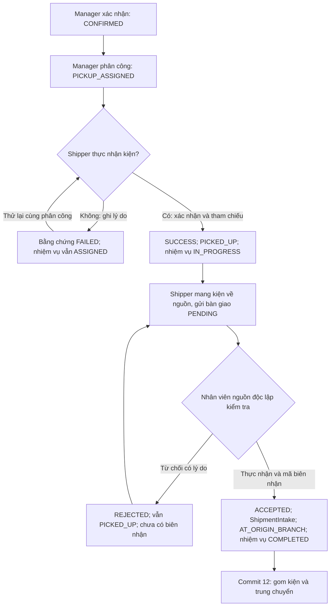

# Commit 11 — HOME_PICKUP và bàn giao nguồn

**Cập nhật Commit 13:** Dashboard có thêm nhiệm vụ DELIVERY, bàn giao đích và yêu cầu thu hồi.
Xem [last-mile-delivery.md](last-mile-delivery.md); nghiệp vụ PICKUP và bàn giao nguồn dưới đây giữ nguyên.

**Cập nhật Commit 12:** Kiện đã có biên nhận nguồn đi vào luồng chuyến/hub tại [transport-hub.md](transport-hub.md).
Pickup/handoff nguồn giữ nguyên; không dùng ShipmentIntake để tạo biên nhận các hub/chặng sau.

Nhánh `feature/an-shipper-pickup`. Tái sử dụng phân công Commit 10, snapshot phí Commit 09 và biên nhận nguồn V5.
Source hiện tại không có ShipmentEventType: giữ ShipmentEvent với from/to status, title, description, actor, branch và UTC.

## Quy trình

Pickup thất bại giữ ASSIGNED/PICKUP_ASSIGNED để thử lại, hoặc Manager phân công lại nhiệm vụ còn chờ theo Commit 10.
Mỗi lần thử ghi một PickupEvidence và event, tăng version. Chỉ một lần SUCCESS cho mỗi assignment.
Sau thành công không đổi Shipper qua tính năng phân công lại cũ; nhiệm vụ chỉ COMPLETED khi chi nhánh thực nhận.
Từ chối bàn giao giữ nhiệm vụ IN_PROGRESS; Shipper xử lý lý do rồi gửi yêu cầu mới. Không sửa/xóa yêu cầu cũ.

## Route

| Method | Route | Mục đích |
|---|---|---|
| GET | `/shipper` | Tổng nhiệm vụ đang thực hiện, chờ lấy, đã lấy, bàn giao chờ |
| GET | `/shipper/pickups?page=0` | Nhiệm vụ và lịch sử riêng, 20 dòng/trang |
| GET | `/shipper/pickups/{assignmentId}` | Chi tiết; evidencePage/handoffPage độc lập, 20 dòng/trang |
| POST | `/shipper/pickups/{assignmentId}/collect` | expectedVersion, result, physicallyCollected, reference, notes |
| POST | `/shipper/pickups/{assignmentId}/handoffs` | expectedVersion, notes |
| GET | `/manager/handoffs?page=0` | PENDING thuộc chi nhánh ACTIVE được gán; 20 dòng/trang |
| GET | `/manager/handoffs/{handoffId}` | Bằng chứng, kết quả xử lý, liên kết vận đơn và biên nhận |
| POST | `/manager/handoffs/{handoffId}/accept` | expectedVersion, physicallyReceived=true, receiptReference, reason tùy chọn |
| POST | `/manager/handoffs/{handoffId}/reject` | expectedVersion và reason bắt buộc; không xác nhận đã nhận kiện |

Link trong trang Tài khoản theo role, nav Shipper/Manager và chi tiết vận đơn Manager. Thymeleaf/Bootstrap nội bộ,
tiếng Việt, responsive; thời gian UTC. DTO Shipper chỉ có liên hệ người gửi cần cho pickup, không có giá/COD/người nhận.
Nhiệm vụ đã hủy/hoàn thành vẫn xem lịch sử; thao tác chỉ xuất hiện khi đủ điều kiện và luôn được kiểm tra lại khi ghi.

## V6 và bằng chứng

`V6__add_pickup_evidence_and_origin_handoffs.sql` chỉ thêm hai bảng, không sửa V1–V5 hoặc dữ liệu cũ:

- `pickup_evidence`: Shipment, assignment, Employee, User thực hiện, result SUCCESS/FAILED,
  reference NVARCHAR(100), notes NVARCHAR(500), recorded_at DATETIME2(7) UTC.
  CHECK buộc SUCCESS có tham chiếu và FAILED có lý do. Filtered unique assignment_id khi SUCCESS;
  cho phép nhiều lần thất bại. Index assignment/thời gian cho lịch sử.
- `origin_handoffs`: Shipment, assignment, evidence, chi nhánh nguồn, Employee/User giao, PENDING/ACCEPTED/REJECTED,
  notes và thời điểm yêu cầu; User/Employee xử lý, thời điểm xử lý và lý do. CHECK đủ thông tin xử lý,
  lý do từ chối và hai bên độc lập. Filtered unique shipment_id khi PENDING; index branch/status/thời gian và assignment/thời gian.

BIGINT IDENTITY, FK NO ACTION, enum VARCHAR(20), NVARCHAR và UTC 100 ns; không cascade xóa hoặc backfill chứng cứ.
V6 khai báo SET options cho filtered index. Service xác minh quan hệ chéo Shipment–assignment–evidence–handoff:
FK đơn không thể tự chứng minh các dòng trỏ cùng Shipment/Employee. Hibernate 7 mapping đối chiếu schema tích lũy V1–V6 offline.
ShipmentIntake V5 giữ unique shipment_id cho biên nhận nguồn; HOME_PICKUP trỏ đúng pickup_assignment_id.
Không dùng biên nhận này cho hub/đích hoặc bàn giao nhiều chặng.
Tham chiếu/checkbox là xác nhận có trách nhiệm, chưa phải chứng cứ độc lập. Không thu thập hoặc tự tạo ảnh/chữ ký/GPS.

## Quyền và transaction

- Mỗi lần xem/ghi Shipper: đọc lại User ACTIVE, ROLE_SHIPPER thực trong DB, Employee ACTIVE liên kết đúng User,
  COURIER_DRIVER, chi nhánh ACTIVE. Nhiệm vụ xem theo Employee; nhiệm vụ người khác trả 404.
- Ghi cần đúng phân công PICKUP hiện tại ASSIGNED/IN_PROGRESS chưa đóng, HOME_PICKUP và Employee thuộc nguồn.
  Không coi role, status hoặc dữ liệu PICKED_UP cũ đơn lẻ là bằng chứng thực nhận.
- Manager đọc lại role/tài khoản, kiểm tra ManagerBranch và chi nhánh ACTIVE. Tiếp nhận/từ chối cần Employee ACTIVE
  cùng nguồn, DISPATCHER hoặc WAREHOUSE_STAFF như Commit 10. Manager chưa đủ hồ sơ chỉ xem; không mở quyền cho nhân viên không có ROLE_MANAGER.
- Chặn tự nhận bằng cả User ID và Employee ID, kể cả dual-role hoặc đã đổi vị trí. ADMIN không kế thừa hai role tác nghiệp.
  CSRF mọi POST; giữ handler HTML 401/403 và API problem JSON 401/403 hiện có, không đổi login/logout.
- Form allowlist từ chối actorId/employeeId/shipmentId/branchId/status. ID đích lấy từ PathVariable;
  field tên giống URI không là property form và không thay đích thao tác. ExpectedVersion không phải quyền truy cập.
- Writer đều trong ShipmentLifecycleService cùng transaction. Tra assignment/handoff lấy scalar shipmentId,
  khóa Shipment PESSIMISTIC_WRITE trước khi nạp entity có thể thay đổi, rồi kiểm tra expectedVersion và phân công/bằng chứng.
  Tránh entity cũ trong persistence context khi chờ khóa. Thứ tự: Shipment → assignment/evidence/handoff/intake.
- @Version, unique evidence SUCCESS, unique handoff PENDING và unique intake bảo vệ thêm. Không tự retry form cũ;
  thao tác cùng trạng thái vẫn tăng version. Bấm lặp phải tải lại và kiểm tra dữ liệu.
- Accept: xử lý handoff + lưu intake + đóng assignment + đặt current_branch_id nguồn + status + event cùng transaction;
  lỗi lưu bất kỳ bước nào phải rollback. Controller không thay status trực tiếp.
- Event tóm tắt tối đa 500 ký tự; nội dung đầy đủ trong evidence/handoff. Render th:text. Không mở whitelist Public Tracking:
  bằng chứng/biên nhận/ghi chú/danh tính nhân viên không công khai.

## Kiểm tra và giới hạn

MVC test dùng security chain, method security, service, guard và Thymeleaf thật; repository được giả lập.
Transaction test dùng Spring TransactionInterceptor; concurrency test có hai thread với mô hình khóa parent.
Không tuyên bố đã chứng minh rollback JDBC, SQL Server locking hoặc filtered index thật bằng các test này.
Không bật test SQL Server opt-in, khởi động ứng dụng vào DB thật, chạy V6/Flyway hoặc ddl-auto=validate.
Kết quả kiểm tra ngày 18/10/2026:

- `mvnw.cmd clean test`: BUILD SUCCESS; 462 test, 461 đạt, 0 failure, 0 error, 1 SQL Server opt-in bỏ qua.
  Có 50 test mới (35 MVC/flow và 15 lifecycle/transaction/concurrency); regression Commit 01–10 đạt.
- `mvnw.cmd -DskipTests compile`: BUILD SUCCESS.
- `git diff --check`: không có lỗi; 25 file mới, 15 file sửa, không stage/commit.
- Hibernate offline: 24 Entity/Repository, 60 FK/quan hệ LAZY, 16 unique constraint, 23 IDENTITY,
  29 cột enum; filtered unique index V6 được kiểm tra từ SQL riêng.
- Cảnh báo còn lại: Maven metadata repository Flyway community HTTP 401, Mockito/Byte Buddy tự nạp Java agent,
  Hibernate nhắc dialect tường minh trong test offline. Không làm build thất bại.

Kiểm tra trình duyệt sau khi V6 được duyệt/áp dụng có chủ đích trên môi trường thử nghiệm có dữ liệu hợp lệ:
Manager xác nhận/phân công HOME_PICKUP → Shipper vào Tài khoản → Nhiệm vụ lấy hàng → ghi nhận thực nhận/tham chiếu
→ mang kiện về nguồn, gửi bàn giao → tài khoản Manager/Employee tiếp nhận khác vào Bàn giao chờ nhận
→ kiểm tra thực tế, mã biên nhận và xác nhận. Thử từ chối có lý do rồi gửi lại, hai tab cùng form, nhiệm vụ khác, chi nhánh khác.
Không tạo dữ liệu giả để vượt guard. BRANCH_DROPOFF tiếp tục intake Commit 10; HOME_PICKUP không đi tắt qua đó.
Đơn legacy method=null không tự gán phương thức; không tính lại phí/snapshot, không thay User/Admin/OTP/public projection.

## Bàn giao Commit 12

Kiện bước tiếp theo cần AT_ORIGIN_BRANCH và biên nhận nguồn. Commit 12 thiết kế chuyến gom nhiều kiện,
kho/hub/phân loại/trung chuyển, custody/biên nhận nhiều chặng riêng; tiếp tục khóa parent, scope và event atomically.
Không tái dùng unique biên nhận nguồn cho mọi chặng. Chưa triển khai transport trips, last-mile Commit 13,
ảnh/chữ ký/GPS, đổi Shipper sau thực nhận, quản trị Employee/ManagerBranch, realtime, hủy/hoàn tiền sau pickup.

## Danh sách file Commit 11

**New files (25)**

- [`docs/shipper-pickup.md`](../docs/shipper-pickup.md)
- [`src/main/java/com/ute/uteexpress/controller/ManagerHandoffController.java`](../src/main/java/com/ute/uteexpress/controller/ManagerHandoffController.java)
- [`src/main/java/com/ute/uteexpress/controller/ShipperPickupController.java`](../src/main/java/com/ute/uteexpress/controller/ShipperPickupController.java)
- [`src/main/java/com/ute/uteexpress/dto/shipment/HandoffReviewCommand.java`](../src/main/java/com/ute/uteexpress/dto/shipment/HandoffReviewCommand.java)
- [`src/main/java/com/ute/uteexpress/dto/shipment/OriginHandoffCommand.java`](../src/main/java/com/ute/uteexpress/dto/shipment/OriginHandoffCommand.java)
- [`src/main/java/com/ute/uteexpress/dto/shipment/PickupCollectionCommand.java`](../src/main/java/com/ute/uteexpress/dto/shipment/PickupCollectionCommand.java)
- [`src/main/java/com/ute/uteexpress/dto/shipper/PickupForms.java`](../src/main/java/com/ute/uteexpress/dto/shipper/PickupForms.java)
- [`src/main/java/com/ute/uteexpress/dto/shipper/PickupViews.java`](../src/main/java/com/ute/uteexpress/dto/shipper/PickupViews.java)
- [`src/main/java/com/ute/uteexpress/entity/OriginHandoff.java`](../src/main/java/com/ute/uteexpress/entity/OriginHandoff.java)
- [`src/main/java/com/ute/uteexpress/entity/PickupEvidence.java`](../src/main/java/com/ute/uteexpress/entity/PickupEvidence.java)
- [`src/main/java/com/ute/uteexpress/enums/HandoffStatus.java`](../src/main/java/com/ute/uteexpress/enums/HandoffStatus.java)
- [`src/main/java/com/ute/uteexpress/enums/PickupResult.java`](../src/main/java/com/ute/uteexpress/enums/PickupResult.java)
- [`src/main/java/com/ute/uteexpress/repository/OriginHandoffRepository.java`](../src/main/java/com/ute/uteexpress/repository/OriginHandoffRepository.java)
- [`src/main/java/com/ute/uteexpress/repository/PickupEvidenceRepository.java`](../src/main/java/com/ute/uteexpress/repository/PickupEvidenceRepository.java)
- [`src/main/java/com/ute/uteexpress/service/ManagerHandoffService.java`](../src/main/java/com/ute/uteexpress/service/ManagerHandoffService.java)
- [`src/main/java/com/ute/uteexpress/service/ShipperPickupService.java`](../src/main/java/com/ute/uteexpress/service/ShipperPickupService.java)
- [`src/main/resources/db/migration/V6__add_pickup_evidence_and_origin_handoffs.sql`](../src/main/resources/db/migration/V6__add_pickup_evidence_and_origin_handoffs.sql)
- [`src/main/resources/templates/manager/handoff-detail.html`](../src/main/resources/templates/manager/handoff-detail.html)
- [`src/main/resources/templates/manager/handoffs.html`](../src/main/resources/templates/manager/handoffs.html)
- [`src/main/resources/templates/shipper/dashboard.html`](../src/main/resources/templates/shipper/dashboard.html)
- [`src/main/resources/templates/shipper/detail.html`](../src/main/resources/templates/shipper/detail.html)
- [`src/main/resources/templates/shipper/fragments.html`](../src/main/resources/templates/shipper/fragments.html)
- [`src/main/resources/templates/shipper/pickups.html`](../src/main/resources/templates/shipper/pickups.html)
- [`src/test/java/com/ute/uteexpress/security/ShipperPickupFlowTests.java`](../src/test/java/com/ute/uteexpress/security/ShipperPickupFlowTests.java)
- [`src/test/java/com/ute/uteexpress/service/PickupLifecycleTests.java`](../src/test/java/com/ute/uteexpress/service/PickupLifecycleTests.java)

**Modified files (15)**

- [`docs/logistics-core.md`](../docs/logistics-core.md)
- [`docs/manager-logistics.md`](../docs/manager-logistics.md)
- [`src/main/java/com/ute/uteexpress/config/SecurityConfig.java`](../src/main/java/com/ute/uteexpress/config/SecurityConfig.java)
- [`src/main/java/com/ute/uteexpress/repository/ShipmentAssignmentRepository.java`](../src/main/java/com/ute/uteexpress/repository/ShipmentAssignmentRepository.java)
- [`src/main/java/com/ute/uteexpress/service/LogisticsAccessService.java`](../src/main/java/com/ute/uteexpress/service/LogisticsAccessService.java)
- [`src/main/java/com/ute/uteexpress/service/ShipmentLifecycleService.java`](../src/main/java/com/ute/uteexpress/service/ShipmentLifecycleService.java)
- [`src/main/java/com/ute/uteexpress/service/ShipmentTransitionPolicy.java`](../src/main/java/com/ute/uteexpress/service/ShipmentTransitionPolicy.java)
- [`src/main/resources/templates/auth/account.html`](../src/main/resources/templates/auth/account.html)
- [`src/main/resources/templates/manager/detail.html`](../src/main/resources/templates/manager/detail.html)
- [`src/main/resources/templates/manager/fragments.html`](../src/main/resources/templates/manager/fragments.html)
- [`src/test/java/com/ute/uteexpress/CoreDatabaseMappingTests.java`](../src/test/java/com/ute/uteexpress/CoreDatabaseMappingTests.java)
- [`src/test/java/com/ute/uteexpress/security/LogisticsServiceSecurityTests.java`](../src/test/java/com/ute/uteexpress/security/LogisticsServiceSecurityTests.java)
- [`src/test/java/com/ute/uteexpress/security/SecurityConfigTests.java`](../src/test/java/com/ute/uteexpress/security/SecurityConfigTests.java)
- [`src/test/java/com/ute/uteexpress/service/ManagerLifecycleTests.java`](../src/test/java/com/ute/uteexpress/service/ManagerLifecycleTests.java)
- [`src/test/java/com/ute/uteexpress/service/ShipmentLifecycleServiceTests.java`](../src/test/java/com/ute/uteexpress/service/ShipmentLifecycleServiceTests.java)
