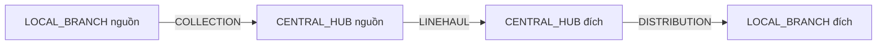

# Commit 12 — Chuyến vận chuyển, hub và bàn giao nhiều chặng

**Cập nhật Commit 13:** TransportTrip/manifest/receipt được tái sử dụng cho tuyến hoàn có cấu hình.
V8 thêm liên kết yêu cầu hoàn trên từng kiện; xem [last-mile-delivery.md](last-mile-delivery.md).
Các giới hạn giao cuối được ghi bên dưới là phạm vi lịch sử của Commit 12.

Nhánh `feature/an-transport-hub`; phụ trách An. Working tree ban đầu sạch; HEAD ban đầu `f176012`
đã có PR Commit 11 và PR `fix/commit11-missing-sources` (`18994f6`). Không stage/commit/push/stash/merge/PR.
Không sửa V1–V6, pom.xml, cấu hình DB/SMTP hoặc dependency. Không chạy migration/database thật trong quá trình triển khai.

## Kiến trúc và định tuyến

Tái sử dụng Branch với LOCAL_BRANCH/CENTRAL_HUB; không tạo hệ thống kho thứ hai.
Shipment giữ origin_branch_id, origin_hub_id, destination_hub_id, destination_branch_id và current_branch_id hiện có.
Hub snapshot của Shipment là nguồn xác định đường đi. Trước khi lập/niêm phong/xuất manifest phải khớp parent_hub_id hiện hành,
đúng loại điểm và ACTIVE; thiếu hoặc thay đổi cấu hình phải báo lỗi, không tự chọn hub hoặc sửa snapshot/giá.

V7 có transport_routes: mỗi cặp điểm đi/đến chỉ một tuyến, leg COLLECTION/LINEHAUL/DISTRIBUTION, cờ ACTIVE.
COLLECTION yêu cầu local.parent_hub là hub đến; DISTRIBUTION yêu cầu local đích.parent_hub là hub đi;
LINEHAUL chỉ giữa hai CENTRAL_HUB khác nhau và phải có dòng tuyến được cấu hình. Không mặc định mọi hub kết nối với nhau.
Form gửi routeId, service đọc lại tuyến và chụp điểm đi/đến/loại chặng lên Trip, không tin điểm đến/hub tự gửi từ client.
Chỉ nhận các chặng liền nhau của đường đi chuẩn; chưa hỗ trợ đồ thị tùy ý qua nhiều hub trung gian ngoài hai hub snapshot.
Không seed tuyến, chi nhánh hoặc dữ liệu vận hành giả. Chưa có UI quản trị tuyến; dữ liệu cần được người có thẩm quyền
cấu hình có chủ đích theo quy trình vận hành trước khi dùng. Khi không có tuyến hợp lệ, UI báo thiếu dữ liệu và không tạo chuyến.

- Hai chi nhánh cùng hub: đường đi local nguồn → hub chung → local đích, hai chuyến và hai biên nhận thực.
  Hub chung dùng AT_DESTINATION_HUB sau một lần kiểm nhận; không tạo chặng LINEHAUL hoặc biên nhận hub thứ hai giả.
- Nguồn và đích cùng chi nhánh: không tạo chuyến hoặc biên nhận mới. Nhân viên nguồn hợp lệ xác nhận kiện thực sự có mặt
  và phân loại tại chỗ từ AT_ORIGIN_BRANCH sang AT_DESTINATION_BRANCH; tái sử dụng biên nhận nguồn đã có, lưu event phân loại.
- Đơn cũ method/hub null không được tự suy diễn. Dữ liệu thiếu liên kết phải được xem xét qua quy trình sửa dữ liệu riêng;
  Commit 12 không backfill hoặc tự sửa. HOME_PICKUP và BRANCH_DROPOFF đều cần biên nhận nguồn thực tế.
  HOME_PICKUP còn kiểm tra nhiệm vụ PICKUP trên biên nhận đã COMPLETED, đúng Shipment, có completed_at.

## Vòng đời chuyến và manifest

`DRAFT → SEALED → DEPARTED → RECONCILING → CLOSED`.

- DRAFT: tạo theo tuyến cấu hình, thêm nhiều kiện ở đúng điểm đi/chặng kế tiếp, có biên nhận nguồn và không còn nhiệm vụ xung đột.
  Kiện ở hub phải có TripReceipt của chặng trước tại chính hub đó; chỉ status/current_branch_id không đủ.
  Một lần thêm 1–50 kiện khác nhau, mỗi chuyến tối đa 500 kiện. UI phân trang 20 kiện, có thể thêm qua nhiều trang/lần.
  Tất cả kiện trong batch được kiểm tra trước khi ghi; ghi manifest và event trong một transaction.
- SEALED: kiểm tra lại toàn bộ manifest, giữ chỗ từng kiện, tuyến và custody; chốt expected_count, actor, thời gian và tham chiếu niêm phong.
  Không niêm phong rỗng; không sửa manifest sau niêm phong. Không có thao tác xóa âm thầm khỏi chuyến đã xuất phát.
- DEPARTED: nhân viên điểm đi xác nhận xuất thực tế, kiểm tra lại đủ manifest/giữ chỗ/tuyến/custody. Ghi người xuất User + Employee,
  tham chiếu và UTC. Các Shipment sang IN_TRANSIT, current_branch_id=null; không gán đã đến nơi.
- RECONCILING: người có thẩm quyền tại điểm đến ghi nhận xe/chuyến đã đến; chỉ cập nhật Trip, không tạo biên nhận hoặc sửa Shipment.
- CLOSED: chỉ khi expected_count > 0, số manifest khớp số đã niêm phong, mọi item RECEIVED và không còn sai lệch OPEN.
  Không đóng bỏ qua kiện thiếu, không tự coi chặng tiếp theo đã hoàn thành.

Manifest item tồn tại lâu dài, unique(trip_id, shipment_id); giữ chỗ is_active=true từ khi thêm vào DRAFT đến khi thực nhận.
Filtered unique shipment_id khi is_active=1 chặn một kiện đồng thời nằm trong nhiều chuyến đang giữ kiện.
Kiện đã được nhận có thể đi chặng tiếp theo trước khi chuyến cũ đóng; các kiện chưa nhận của chuyến cũ vẫn bị giữ riêng.
expected_count được chốt tại seal; số đã nhận/thiếu/hỏng/từ chối/sai lệch được đếm từ dữ liệu item/discrepancy, không tin số client gửi.

## Kiểm nhận và sai lệch

TripReceipt unique item_id, một biên nhận thực cho một kiện của một chặng. Cần chuyến RECONCILING đã xuất,
đúng item trong manifest, đúng Shipment đang IN_TRANSIT và chưa có biên nhận, xác nhận thực nhận và tham chiếu tối đa 100 ký tự.
Biên nhận lưu User/Employee nhận, Branch đích, thời gian UTC và notes. Chỉ lúc này mới đặt current_branch_id và mốc nhận:
AT_ORIGIN_HUB, AT_DESTINATION_HUB hoặc AT_DESTINATION_BRANCH theo điểm đến của chặng hợp lệ.
Không tái dùng ShipmentIntake V5 cho hub/đích; bảng đó chỉ là biên nhận nguồn.

Sai lệch có actor/Employee, thời gian, loại, tham chiếu và lý do bắt buộc:

- MISSING/DAMAGED/REJECTED: phải trỏ đúng item của chuyến, chưa RECEIVED. Giữ is_active=true,
  Shipment vẫn IN_TRANSIT/current_branch_id=null, không sinh biên nhận. Mỗi item tối đa một sai lệch OPEN.
  Muốn xử lý phải tìm/kiểm tra đúng kiện và gửi biên nhận thực tế kèm checkbox đã xử lý sai lệch + kết quả kiểm tra.
  Khi nhận, service kết thúc sai lệch, lưu người/thời gian và tham chiếu biên nhận; nội dung kiểm tra đầy đủ lưu tại TripReceipt.
- UNEXPECTED: kiện không khớp/ngoài manifest chỉ ghi quan sát/tham chiếu, item_id=null. Không tự tìm vận đơn ngoài phạm vi,
  thêm kiện vào manifest hoặc nhận kiện này. Người nhận cách ly/đối chiếu và ghi xác nhận xử lý có tham chiếu/lý do riêng để kết thúc.
  Event xử lý ghi ID sai lệch; discrepancy giữ User/Employee/thời gian/kết quả xử lý đầy đủ.

Chuyến còn sai lệch không được đóng. Sau CLOSED mọi thao tác ghi bị chặn, không sửa/xóa biên nhận hoặc lịch sử cũ.
Sai lệch phát hiện sau khi đóng, mất kiện vĩnh viễn, bồi thường, trả/hủy hoặc mở lại chuyến cần nghiệp vụ ngoại lệ có audit riêng;
chưa triển khai trong commit này. Không tạo trạng thái/biên nhận giả để đóng cho xong.

## Lifecycle, lịch sử và bảo mật

TransportTripService là lớp lifecycle tập trung cho vận chuyển, tương ứng ShipmentLifecycleService của pickup/intake;
controller chỉ tạo command. Mọi Shipment transition mới được kiểm tra graph ShipmentTransitionPolicy;
generic transition cũ vẫn không mở các cạnh vật lý để bỏ qua trip/receipt. Không thêm ShipmentStatus hoặc sửa CHECK status cũ.
Manifest, xuất chuyến, kiểm nhận, sai lệch có ShipmentEvent + TransportTripEvent khi gắn với kiện;
niêm phong/xe đến/đóng chuyến có TripEvent thực tế, không giả lập event đã nhận cho từng Shipment.
Đơn cùng chi nhánh có event phân loại tại chỗ; không giả lập hành trình.

SecurityConfig đã bảo vệ /manager/** bằng ROLE_MANAGER nên không mở matcher mới. Controller, read service và writer có method security.
LogisticsAccessService đọc lại User ACTIVE và role DB trong mỗi lần thao tác; không dùng role session làm căn cứ duy nhất.
Hub chỉ thuộc quyền khi có ManagerBranch đúng hub ACTIVE. Không kế thừa quyền Manager cho ADMIN hoặc SHIPPER.

- Tạo/thêm kiện: MANAGER phụ trách điểm đi; lập kế hoạch chưa cần Employee.
- Niêm phong/xuất: thêm điều kiện Employee ACTIVE liên kết đúng User, cùng điểm đi, DISPATCHER hoặc WAREHOUSE_STAFF.
- Xe đến/nhận/sai lệch/đóng: MANAGER phụ trách điểm đến và Employee tiếp nhận hợp lệ tại đúng điểm đến.
  Kiểm tra độc lập bằng cả User ID và Employee ID so với người xuất/đại diện bên giao, kể cả dual-role/đổi vị trí.
  Chưa có phân công lái xe/phương tiện; người xuất là bên bàn giao được định danh, không giả định họ là tài xế.
- Xem chuyến: có ManagerBranch ACTIVE ở ít nhất một đầu; xem lịch sử Shipment chỉ trả các chặng thuộc phạm vi đó.
  Hub không có quyền sửa yêu cầu nguồn qua endpoint Manager Commit 10 của chi nhánh khác.
  DTO transport riêng không có điện thoại/địa chỉ người gửi/nhận, COD, giá trị hàng hóa hoặc phí.
- CSRF mọi POST; GET không ghi dữ liệu. Form allowlist chặn actorId/employeeId/destinationId/status tùy ý.
  Trip ID lấy từ URI, item/shipment/route ID luôn tra DB và kiểm tra quan hệ/scope, không là quyền truy cập tự thân.
  Lỗi 401/403 HTML/API giữ handler hiện có; lỗi dữ liệu/unique/xung đột không trả stacktrace/SQL ra flash.
- Giữ nguyên projection và whitelist Guest Tracking; event transport/biên nhận/tham chiếu/sai lệch/danh tính nhân viên không tự công khai.
  Thông tin hiển thị bằng th:text; notes không render thành HTML.

## Transaction và concurrency

Mọi writer @Transactional. Tất cả thao tác có trip hiện tại khóa TransportTrip PESSIMISTIC_WRITE rồi kiểm tra version.
Khi cần kiểm tra/sửa kiện: lấy scalar Shipment IDs, khóa Shipment bằng findForLifecycle theo ID tăng dần,
rồi mới nạp item/receipt/discrepancy. Không nạp Shipment entity trước khi chờ khóa để tránh dùng persistence context cũ.
Commit 10/11 vẫn dùng khóa Shipment trước các bảng con của chúng và không khóa Trip, không đảo thứ tự mới.
Không khóa nhiều Trip cùng một thao tác; batch bị giới hạn để kiểm soát kích thước transaction.
Parent Shipment @Version tiếp tục tăng cả khi ghi event cùng trạng thái; Trip có @Version và updated_at tăng cho mọi thao tác.
Mọi POST trừ create cần expectedVersion, không tự retry form cũ. Close/receipt/add/seal/depart cùng khóa Trip nên không ghi đè nhau.

Create có request_token unique, gắn với người tạo: gửi lại cùng token/tuyến trả cùng chuyến; token đã dùng cho tuyến khác bị từ chối.
Hai create đồng thời còn có unique DB làm lớp bảo vệ cuối, một yêu cầu có thể nhận lỗi xung đột an toàn; không tạo hai chuyến cùng token.
Filtered unique reservation + khóa Shipment bảo vệ hai chuyến tranh cùng kiện. Unique receipt/item và khóa Trip/Shipment bảo vệ nhận lặp.
Lỗi lưu receipt/item/ShipmentEvent/TripEvent làm rollback transaction, không coi ghi một phần là thành công.
FK đơn không tự chứng minh item, receipt và discrepancy thuộc đúng một Trip/Shipment hoặc đúng loại điểm;
service kiểm tra các ràng buộc liên bảng này, không tuyên bố filtered index đã thay thế chúng.

## V7

`V7__add_transport_trips_and_hub_handoffs.sql`: 6 bảng và 6 Entity/Repository tương ứng:

| Entity | Bảng | Ràng buộc chính |
|---|---|---|
| TransportRoute | transport_routes | UNIQUE hai điểm, CHECK khác điểm/loại chặng |
| TransportTrip | transport_trips | UNIQUE code và request_token, version, CHECK trạng thái/mốc niêm phong/xuất/đến/đóng |
| TransportTripItem | transport_trip_items | UNIQUE trip+shipment, filtered UNIQUE active shipment, CHECK tình trạng/giữ chỗ |
| TripReceipt | trip_receipts | UNIQUE item, FK điểm nhận/User/Employee, CHECK tham chiếu |
| TripDiscrepancy | trip_discrepancies | CHECK loại/item/tình trạng/kết thúc, filtered UNIQUE item OPEN |
| TransportTripEvent | transport_trip_events | FK Trip/item/actor/Employee/Branch, CHECK loại event và from/to status |

BIGINT IDENTITY, VARCHAR enum, NVARCHAR cho nội dung tiếng Việt, BIT, DATETIME2(7) UTC và mặc định SYSUTCDATETIME.
FK NO ACTION, mọi ManyToOne LAZY, không cascade REMOVE/ALL hoặc orphanRemoval. Không seed/backfill.
SET options cho filtered index được khai báo. Mọi cột/PK/FK/CHECK/default/index được đối chiếu với Hibernate offline;
chưa thực thi DDL/validate/index trên SQL Server Express thật.

## Route thực tế

| Method | Route | Công việc |
|---|---|---|
| GET | /manager/trips | Danh sách trong phạm vi, page |
| GET | /manager/trips/new | Tuyến nguồn được gán, page |
| POST | /manager/trips | Tạo theo routeId/requestToken |
| GET | /manager/trips/{tripId} | Chi tiết; itemPage/candidatePage/issuePage/eventPage độc lập |
| POST | /manager/trips/{tripId}/items | Thêm nhiều shipmentIds |
| POST | /manager/trips/{tripId}/seal | Niêm phong |
| POST | /manager/trips/{tripId}/depart | Xuất chuyến |
| POST | /manager/trips/{tripId}/arrive | Xe/chuyến đến để kiểm đếm |
| POST | /manager/trips/{tripId}/receipts | Nhận một itemId thực tế |
| POST | /manager/trips/{tripId}/discrepancies | Sai lệch item hoặc ngoài manifest |
| POST | /manager/trips/{tripId}/discrepancies/resolve | Kết thúc sai lệch UNEXPECTED |
| POST | /manager/trips/{tripId}/close | Đóng chuyến đủ điều kiện |
| GET | /manager/trips/local-ready | Kiện nguồn/đích cùng chi nhánh, page |
| POST | /manager/trips/local-ready | Phân loại tại chỗ có kiểm tra và version Shipment |
| GET | /manager/trips/shipments/{shipmentId}/history | Lịch sử các chặng thuộc phạm vi, page |

Toàn bộ danh sách, ứng viên, manifest, lịch sử, sai lệch phân trang 20 dòng tại database bằng truy vấn có scope,
không tải tất cả Shipment rồi phân trang trong Java. Khi seal/depart, xử lý manifest giới hạn tối đa 500 trong một transaction,
không phải phân trang UI. Nav Manager có link Chuyến & hub; chi tiết vận đơn Manager có link lịch sử chặng.

## Kiểm thử thủ công và giới hạn

Chỉ khởi động ứng dụng/Flyway có chủ đích trên môi trường thử nghiệm đã được duyệt. Chuẩn bị dữ liệu thực hợp lệ:
local/hub ACTIVE và parent đúng, các tuyến ACTIVE, ManagerBranch tại từng điểm, Employee ACTIVE đúng vị trí và liên kết User.
Không tạo dữ liệu giả hoặc tự cấp quyền SQL Server để vượt guard.

1. Cho HOME_PICKUP hoàn tất Commit 11 hoặc BRANCH_DROPOFF hoàn tất Commit 10: có ShipmentIntake và AT_ORIGIN_BRANCH.
2. Manager nguồn → Chuyến & hub → Tạo chuyến → chọn tuyến nguồn/hub; chọn nhiều kiện và niêm phong có tham chiếu.
3. Xác nhận xuất thực tế. Kiểm tra Shipment IN_TRANSIT và chưa có receipt tại hub.
4. Manager/Employee hub → ghi chuyến đã đến; kiểm tra chưa đổi vị trí Shipment. Thực nhận từng kiện với biên nhận riêng.
5. Thử MISSING/DAMAGED/REJECTED: không có receipt, không thể cho kiện đi tiếp/đóng chuyến; chỉ nhận sau tìm/kiểm tra thực tế và ghi xử lý.
6. Thử kiện ngoài manifest: ghi quan sát, cách ly/đối chiếu, kết thúc sai lệch có lý do; không tự thêm vào manifest.
7. Tạo chuyến hub–hub rồi hub–local, lặp lại xuất/đến/kiểm nhận. AT_DESTINATION_BRANCH chỉ xuất hiện sau biên nhận local đích.
8. Thử cùng hub chỉ hai chặng; cùng local dùng phân loại tại chỗ, không chuyến/receipt mới.
9. Thử hai tab form cũ, hai chuyến chọn cùng kiện, Manager sai điểm, thiếu Employee, actor bị khóa/thu hồi role, ADMIN/SHIPPER, thiếu CSRF.
10. Kiểm tra Guest Tracking không lộ trip code, tham chiếu, ghi chú, khách hàng hoặc nhân viên; phí snapshot không đổi.

Test tự động dùng Hibernate 7 thật để bootstrap mapping/query không JDBC, MVC/Thymeleaf/Spring Security/service thật với repository giả lập.
Concurrency test có hai thread và mô hình khóa; rollback test dùng Spring TransactionInterceptor.
Chúng kiểm tra hợp đồng service và quyết định rollback, không chứng minh JDBC rollback, SQL Server deadlock/lock scope hoặc hiệu lực unique thật.
Không bật test SQL Server opt-in, không kết nối DB thật, không chạy V7, Flyway hoặc ddl-auto=validate. Cần kiểm thử riêng trên SQL Server thử nghiệm được phép.

Kết quả `mvnw.cmd clean test` ngày 23/10/2026: BUILD SUCCESS; 527 test, 526 đạt, 0 failure, 0 error,
1 SQL Server opt-in bỏ qua. Có 65 test mới: 6 network, 36 lifecycle/manifest/handoff/concurrency/rollback,
3 read scope/paging và 20 MVC/security/template/flow; regression Commit 01–11 đạt.
Hibernate offline kiểm tra 30 Entity/Repository, 88 FK/quan hệ LAZY, 21 unique constraint,
29 IDENTITY, 38 cột enum; filtered unique index được kiểm tra riêng từ SQL.
`mvnw.cmd -DskipTests compile`: BUILD SUCCESS. `git diff --check`: không có lỗi.
39 file mới (đều chưa Git theo dõi), 9 file sửa; không có file staged, build/log/secret lẫn vào danh sách thay đổi.
Cảnh báo còn lại: metadata repository Flyway community HTTP 401; Mockito/Byte Buddy tự nạp agent;
Hibernate nhắc SQLServerDialect tường minh trong test offline. Không làm build thất bại.

## Bàn giao Commit 13

Chỉ kiện AT_DESTINATION_BRANCH, current_branch_id đúng đích và có biên nhận chặng cuối (hoặc biên nhận nguồn + event phân loại
tại cùng chi nhánh) mới vào bước phân công giao cuối. Không suy ra hàng đã có mặt từ Trip DEPARTED/RECONCILING.
Commit 13 triển khai DELIVERY assignment, last-mile, thử giao, bằng chứng giao, thất bại/hoàn hàng; tiếp tục guard/khóa parent/event atomically.
Chưa có UI quản trị tuyến/Employee/ManagerBranch, lái xe/phương tiện, chỉnh/hủy DRAFT, đổi manifest đã niêm phong,
mất kiện vĩnh viễn/bồi thường/mở lại CLOSED, đồ thị hub tùy ý, ảnh/chữ ký/GPS hoặc realtime.

## File mới chưa được Git theo dõi

Danh sách lấy trực tiếp bằng `git ls-files --others --exclude-standard` để kiểm tra đủ source trước khi tự stage.
Không có thao tác git add trong công việc này.

Total: 39

- [docs/transport-hub.md](../docs/transport-hub.md)
- [src/main/java/com/ute/uteexpress/controller/TransportTripController.java](../src/main/java/com/ute/uteexpress/controller/TransportTripController.java)
- [src/main/java/com/ute/uteexpress/dto/transport/TripCommands.java](../src/main/java/com/ute/uteexpress/dto/transport/TripCommands.java)
- [src/main/java/com/ute/uteexpress/dto/transport/TripForms.java](../src/main/java/com/ute/uteexpress/dto/transport/TripForms.java)
- [src/main/java/com/ute/uteexpress/dto/transport/TripLabels.java](../src/main/java/com/ute/uteexpress/dto/transport/TripLabels.java)
- [src/main/java/com/ute/uteexpress/dto/transport/TripViews.java](../src/main/java/com/ute/uteexpress/dto/transport/TripViews.java)
- [src/main/java/com/ute/uteexpress/entity/TransportRoute.java](../src/main/java/com/ute/uteexpress/entity/TransportRoute.java)
- [src/main/java/com/ute/uteexpress/entity/TransportTrip.java](../src/main/java/com/ute/uteexpress/entity/TransportTrip.java)
- [src/main/java/com/ute/uteexpress/entity/TransportTripEvent.java](../src/main/java/com/ute/uteexpress/entity/TransportTripEvent.java)
- [src/main/java/com/ute/uteexpress/entity/TransportTripItem.java](../src/main/java/com/ute/uteexpress/entity/TransportTripItem.java)
- [src/main/java/com/ute/uteexpress/entity/TripDiscrepancy.java](../src/main/java/com/ute/uteexpress/entity/TripDiscrepancy.java)
- [src/main/java/com/ute/uteexpress/entity/TripReceipt.java](../src/main/java/com/ute/uteexpress/entity/TripReceipt.java)
- [src/main/java/com/ute/uteexpress/enums/TransportLeg.java](../src/main/java/com/ute/uteexpress/enums/TransportLeg.java)
- [src/main/java/com/ute/uteexpress/enums/TripDiscrepancyKind.java](../src/main/java/com/ute/uteexpress/enums/TripDiscrepancyKind.java)
- [src/main/java/com/ute/uteexpress/enums/TripDiscrepancyStatus.java](../src/main/java/com/ute/uteexpress/enums/TripDiscrepancyStatus.java)
- [src/main/java/com/ute/uteexpress/enums/TripEventType.java](../src/main/java/com/ute/uteexpress/enums/TripEventType.java)
- [src/main/java/com/ute/uteexpress/enums/TripItemStatus.java](../src/main/java/com/ute/uteexpress/enums/TripItemStatus.java)
- [src/main/java/com/ute/uteexpress/enums/TripStatus.java](../src/main/java/com/ute/uteexpress/enums/TripStatus.java)
- [src/main/java/com/ute/uteexpress/repository/TransportRouteRepository.java](../src/main/java/com/ute/uteexpress/repository/TransportRouteRepository.java)
- [src/main/java/com/ute/uteexpress/repository/TransportTripEventRepository.java](../src/main/java/com/ute/uteexpress/repository/TransportTripEventRepository.java)
- [src/main/java/com/ute/uteexpress/repository/TransportTripItemRepository.java](../src/main/java/com/ute/uteexpress/repository/TransportTripItemRepository.java)
- [src/main/java/com/ute/uteexpress/repository/TransportTripRepository.java](../src/main/java/com/ute/uteexpress/repository/TransportTripRepository.java)
- [src/main/java/com/ute/uteexpress/repository/TripDiscrepancyRepository.java](../src/main/java/com/ute/uteexpress/repository/TripDiscrepancyRepository.java)
- [src/main/java/com/ute/uteexpress/repository/TripReceiptRepository.java](../src/main/java/com/ute/uteexpress/repository/TripReceiptRepository.java)
- [src/main/java/com/ute/uteexpress/service/TransportRouting.java](../src/main/java/com/ute/uteexpress/service/TransportRouting.java)
- [src/main/java/com/ute/uteexpress/service/TransportTripReadService.java](../src/main/java/com/ute/uteexpress/service/TransportTripReadService.java)
- [src/main/java/com/ute/uteexpress/service/TransportTripService.java](../src/main/java/com/ute/uteexpress/service/TransportTripService.java)
- [src/main/resources/db/migration/V7__add_transport_trips_and_hub_handoffs.sql](../src/main/resources/db/migration/V7__add_transport_trips_and_hub_handoffs.sql)
- [src/main/resources/templates/transport/detail.html](../src/main/resources/templates/transport/detail.html)
- [src/main/resources/templates/transport/fragments.html](../src/main/resources/templates/transport/fragments.html)
- [src/main/resources/templates/transport/history.html](../src/main/resources/templates/transport/history.html)
- [src/main/resources/templates/transport/list.html](../src/main/resources/templates/transport/list.html)
- [src/main/resources/templates/transport/local.html](../src/main/resources/templates/transport/local.html)
- [src/main/resources/templates/transport/new.html](../src/main/resources/templates/transport/new.html)
- [src/test/java/com/ute/uteexpress/security/TransportTripFlowTests.java](../src/test/java/com/ute/uteexpress/security/TransportTripFlowTests.java)
- [src/test/java/com/ute/uteexpress/service/TransportRoutingTests.java](../src/test/java/com/ute/uteexpress/service/TransportRoutingTests.java)
- [src/test/java/com/ute/uteexpress/service/TransportTripReadServiceTests.java](../src/test/java/com/ute/uteexpress/service/TransportTripReadServiceTests.java)
- [src/test/java/com/ute/uteexpress/service/TransportTripServiceTests.java](../src/test/java/com/ute/uteexpress/service/TransportTripServiceTests.java)
- [src/test/java/com/ute/uteexpress/transport/TransportFixtures.java](../src/test/java/com/ute/uteexpress/transport/TransportFixtures.java)

## File đã sửa

Total: 9

- [docs/logistics-core.md](../docs/logistics-core.md)
- [docs/manager-logistics.md](../docs/manager-logistics.md)
- [docs/shipper-pickup.md](../docs/shipper-pickup.md)
- [src/main/java/com/ute/uteexpress/service/ShipmentTransitionPolicy.java](../src/main/java/com/ute/uteexpress/service/ShipmentTransitionPolicy.java)
- [src/main/resources/templates/manager/detail.html](../src/main/resources/templates/manager/detail.html)
- [src/main/resources/templates/manager/fragments.html](../src/main/resources/templates/manager/fragments.html)
- [src/test/java/com/ute/uteexpress/CoreDatabaseMappingTests.java](../src/test/java/com/ute/uteexpress/CoreDatabaseMappingTests.java)
- [src/test/java/com/ute/uteexpress/security/LogisticsServiceSecurityTests.java](../src/test/java/com/ute/uteexpress/security/LogisticsServiceSecurityTests.java)
- [src/test/java/com/ute/uteexpress/security/SecurityConfigTests.java](../src/test/java/com/ute/uteexpress/security/SecurityConfigTests.java)
